# 📘 MCS-213 — Assignment Workbook
**Course:** Software Engineering (MCS-213) · **Assignment:** MCA_NEW(I)/213/Assign/2026 · **Session:** Jul-2026 (assignment p. 8)
**Assignment pattern:** one case study worth **80 marks + 20 marks viva** — the five parts (a)–(e) are answered as **Q1(a)–Q1(e)** in this workbook.
**Last date of submission:** 30 April 2026 (Jan session) / **31 October 2026 (July session)**.
**TEE pattern (MCAOL online):** short 5×4 + medium 5×10 + long 2×15 = 100 marks. The four archived MCA_NEW papers use the older pattern — Q1 compulsory (4×10) + any 3 of the rest (2×10 each) = 100; every archived part is 10 marks.
**Subject profile:** case-study / design document — one 80-mark case study; IEEE SRS format when asked; state assumptions (`assignment-workbook/references/subject-profiles.md`).
**Book coverage:** complete — Blocks 1–4, Units 1–16, pp. 545–806 of `SEM1/21_MCAOL_SEM1_Study_Material_indexed.pdf`.

> **🧭 How this workbook works (design rules)**
> 1. **Order:** the parts are processed in assignment order (a) → (e), which follows the syllabus (models → requirements → estimation → SRS).
> 2. **Add-only study:** a concept is taught once, where it first appears. Later parts *link* to it — the registry below is the index of what was explained where.
> 3. **Per-part block:** Prerequisite bridge → lessons (new concepts only) → traps/self-check → exam trail → assignment answer → TEE layer → verification. Every answer embeds its **verbatim question text** (the shared case preamble is quoted once, in full, just below) so no other PDF is ever needed.
> 4. **Out-of-order guard:** if a part needs a concept from an uncovered unit, add only a short "missing prerequisite" note (1–3 lines) and continue; its full treatment comes with its own question.
> 5. **Two layers:** the *assignment layer* builds knowledge + the submission answer. The *TEE layer* answers **actual past TEE questions only** — never a made-up "TEE version" of an assignment part. A past question unlocks only when every concept it needs is already in the registry.
> 6. **Dedup applies to teaching, not to exam answers:** a concept is taught once, but every answer is written standalone — it must work in the exam hall with no cross-references.
> 7. **Symbols rule:** never show a symbol or abbreviation without (a) how to read it aloud, (b) why it exists, (c) a tiny example; use a code analogy when natural. Expand every abbreviation on first use.
> 8. **Figures rule:** anything a table cannot explain cleanly gets a picture — generated with `matplotlib` or extracted from the source PDF. Files live in `<workbook>.assets/` and are referenced beside the concept with a numbered caption.

**Marks & time budget (100 marks / 180 min ≈ 1.8 min per mark):**

| TEE slot | Marks | Time | Answer size | Structure |
|---|---|---|---|---|
| Short | 4 | ~7 min | 100–150 words | definition + key points or tiny example |
| Medium | 10 | ~18 min | 300–400 words + small table | definition → method → solve → result |
| Long | 15 | ~27 min | 450–600 words | full treatment, comparison or derivation |

The four archived MCS-213 papers carry only 10-mark parts; each TEE answer below is sized to the marks the paper actually gives.

## 📄 The assignment case (verbatim — MCS-213 assignment, p. 8)

> **Q1 [80 marks].** Assume that you are assigned responsibility of developing an **Online Programme Eligibility Checking System (OPECS)** for a University. **OPECS** should be a web based system. **OPECS** will have fields such as Programme Code (To select the Programme whose eligibility for admission is sought), Qualification Code (To select the Programme which is the qualification of applicant for admission to Programme with Programme Code), Course Codes (To select multiple courses which are part of the Programme with the qualification code), Percentage (To select the nearest aggregate percentage of marks secured in the Programme selected under Qualification code), SUBMIT (a Submit button which when clicked displays whether the candidate whose particulars are filled is eligible for admission to the Programme with Programme Code). Make assumptions wherever necessary.
> For developing **OPECS** as specified above,
> (a) Which SDLC paradigm will be selected. Justify your answer. **(15 Marks)**
> (b) List the functional and non-functional requirements. **(15 Marks)**
> (c) Estimate cost. **(15 Marks)**
> (d) Estimate efforts. **(15 Marks)**
> (e) Develop SRS using IEEE format. **(20 Marks)**

*No figure is given with this question. All five parts share this one case; each answer below re-quotes its own part.*

## 🗂️ Progress

| Part | Topic | Book location | Status |
|---|---|---|---|
| Q1(a) | SDLC paradigm for OPECS + justification | Block 1 U1, pp. 545–561 | ✅ |
| Q1(b) | Functional & non-functional requirements | Block 1 U2, pp. 562–578 | ✅ |
| Q1(c) | Cost estimation (FPA → KLOC → COCOMO → ₹) | Block 2 U5, pp. 608–620 | ✅ |
| Q1(d) | Effort estimation (man-months, phase split) | Block 2 U5, pp. 608–620 | ✅ |
| Q1(e) | IEEE-format SRS for OPECS (with DFDs) | Block 1 U2, pp. 562–578 | ✅ |

## 🧾 Concept registry

| Concept | First taught | Later links |
|---|---|---|
| Software, its differences from engineering products | Q1(a) L0 | Q1(e) L0 |
| Software engineering = process + methods + tools | Q1(a) L0 | — |
| Software process; software crisis | Q1(a) L0 | — |
| SDLC and its five phases | Q1(a) L1 | Q1(b) L0, Q1(e) L2 |
| Build-and-fix model | Q1(a) L2 | — |
| Waterfall model (± feedback) | Q1(a) L2 | Q1(a) TEE, Q1(c) L0 |
| Iterative enhancement / incremental model | Q1(a) L2 | Q1(c) L0 |
| Prototyping model; throw-away vs evolutionary | Q1(a) L2 | Q1(a) TEE |
| Spiral model; risk analysis | Q1(a) L2 | Q1(a) TEE |
| RAD approach | Q1(a) L2 | — |
| Model-selection criteria | Q1(a) L3 | Q1(a) answer |
| Requirement (IEEE 610.12); requirement priorities | Q1(b) L0 | Q1(e) L1 |
| Requirements engineering; RDD | Q1(b) L0 | Q1(e) L1 |
| Functional requirements | Q1(b) L1 | Q1(c/d/e) |
| Non-functional requirements | Q1(b) L1 | Q1(c/d/e) |
| Requirements gathering tools | Q1(b) L1 | — |
| Context diagram (level-0 DFD) | Q1(b) L2 | Q1(e) L2 |
| Project metrics: primitive vs derived; LOC | Q1(c) L0 | Q1(d) L1 |
| Function Point Analysis (5 components, weights, UFP, VAF) | Q1(c) L1 | Q1(c) TEE, Q1(d) answer |
| COCOMO: basic / intermediate / detailed; organic / semi-detached / embedded | Q1(c) L2 | Q1(c) TEE, Q1(d) answer |
| Putnam model; Rayleigh-Norden curve | Q1(c) L2 | Q1(d) TEE |
| Statistical (Walston–Felix) model | Q1(c) L2 | — |
| Effort estimation; person-month; productivity | Q1(c) L2 | Q1(d) L1 |
| Schedule estimation; staffing | Q1(c) L3 | Q1(d) L1 |
| Cost estimation; cost components; contingency | Q1(c) L3 | Q1(d) answer |
| Estimation accuracy and its causes of error | Q1(c) L3 | — |
| Life-cycle effort distribution (10/20/40/30) | Q1(d) L1 | — |
| IEEE-830 SRS outline | Q1(e) L1 | Q1(e) TEE |
| SRS purpose and characteristics | Q1(e) L0 | — |
| DFD rules; levels 0/1/2; data dictionary; E-R diagram | Q1(e) L2 | Q1(e) TEE (railway DFD) |
| Requirement traceability | Q1(e) L3 | — |

---

# Q1(a) — Which SDLC paradigm for OPECS? (15 marks)
*Assignment p. 8 · Book: Block 1, Unit 1 “Software Engineering and its Models”, pp. 545–561*

## 🧰 L0. Prerequisite bridge — what this question silently assumes

| Term | Read it as | What it is & why it exists | Example / code analogy |
|---|---|---|---|
| software | — | programs + procedures + data + documents that make a computer useful; it is *developed*, never manufactured, and never 100 % error-free | `app = code + docs + data` |
| software engineering (SE) | "S-E" | the field that applies an engineering approach to software by combining **process, methods and tools**, so cost, schedule and quality become predictable instead of accidental (Block 1 U1, p. 545) | `SE = process + methods + tools` |
| software process | — | the set of activities performed in a defined sequence to reach a goal; answers *who does what, when and how* (Booch & Rumbaugh) | a CI/CD pipeline: ordered, repeatable |
| SDLC | "S-D-L-C" — Software Development Life Cycle | the phases a software product passes through: Requirements → Design → Coding → Testing → Maintenance | sprint 0 → sprints → release → support |
| process model / paradigm | "paradigm" | one named arrangement of those phases over time — linear, iterative, spiral …; the arrangement decides when risks and feedback are handled | choosing a branching strategy in Git |
| software crisis | — | the recurring failure pattern: overruns, wrong requirements, late defects, maintenance eating 50–80 % of lifetime cost | production incidents caused by missed requirements |

**Why software is not like other engineering products** (Block 1 U1 §1.3, pp. 547–548) — the reason a *process* is needed at all:

| # | Property of software | Consequence for the process |
|---|---|---|
| 1 | changes take effect only through the code (nothing is re-manufactured) | design must anticipate change; maintenance is a first-class phase |
| 2 | invisible and creativity-dependent — same spec by two teams gives different effort | estimates need models, not guesswork |
| 3 | no wear and tear; it “fails” when it is incorrect or lacks features | correctness must be engineered in, not inspected out |
| 4 | can never be 100 % error-free | testing aims to find *inputs that fail*, not to prove absence of errors |
| 5 | reusable | component-based and reuse-driven models become possible |

**Read aloud:** “Which life-cycle model should be used to build the OPECS web system, and why?”

## 🎯 L1. The SDLC phases — the vocabulary the models are built from

**Read aloud:** “Requirements capture *what*; design says *how*; coding writes it; testing tries to break it; maintenance keeps it alive.”

| Phase | Input | Main activity | Output / document |
|---|---|---|---|
| 1. Requirements analysis | user needs, existing system | study and refine needs; resolve conflicts; prioritise | **SRS** — Software Requirements Specification |
| 2. Design | SRS | build the logical system: blocks → modules → database → I/O forms | **SDD** — Software Design Document |
| 3. Coding | SDD | translate module specifications into a high-level language; follow coding standards | source code + documentation |
| 4. Testing | code + requirements | execute on designed inputs with the *intention of finding errors*; debugging then locates and fixes them | test cases, defect reports |
| 5. Maintenance | running system | corrective (fix errors), adaptive (new hardware/software), perfective (new requirements) | updated releases |

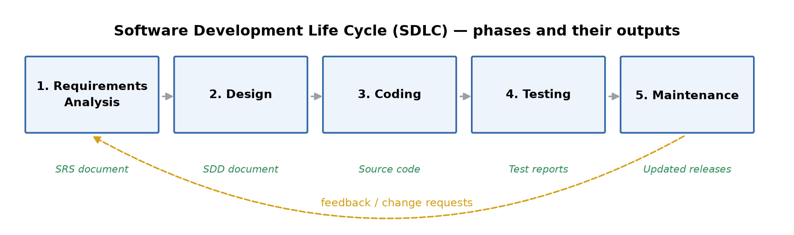
*🖼️ Figure 1 — The five SDLC phases (Block 1 U1 §1.5, p. 555) and the document each hands to the next. The dashed arrow is the feedback every real project has: change requests flow back into requirements and design.*

**Book anchors:** the unit prints exactly these five phases and their documents (Block 1 U1 §1.5, pp. 555–560). “Requirements” is *what* the system must do; design and code are *how*.

## 🔁 L2. The six process models of Unit 1 — one picture each

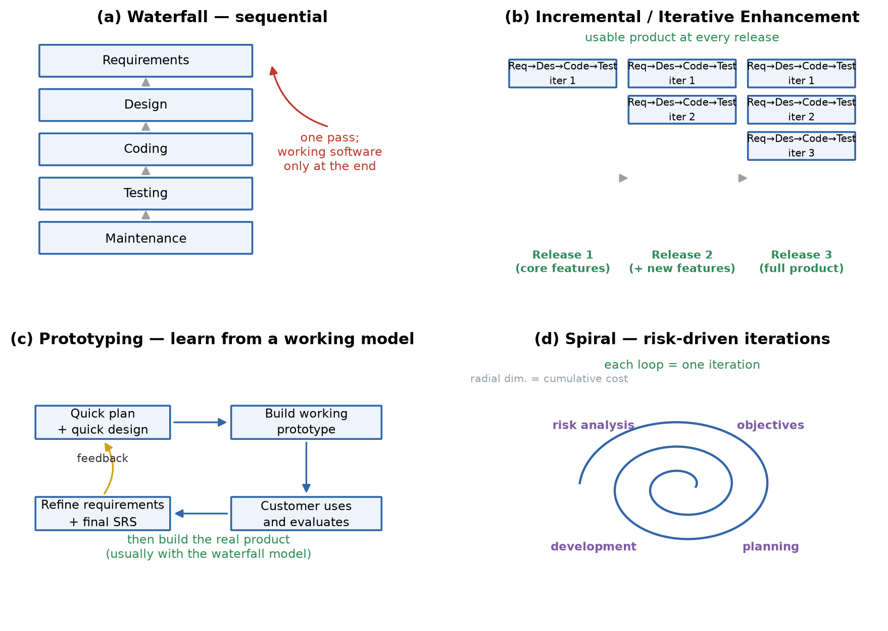
*🖼️ Figure 2 — The four models that matter for OPECS: (a) waterfall, (b) incremental, (c) prototyping, (d) spiral. Build-and-fix and RAD are described in the table below.*

| Model | How it works | Strengths | Weaknesses |
|---|---|---|---|
| **Build-and-fix** | code first, fix until the client is satisfied; no requirements or design phase | trivial for one-person throw-away programs | no planning, no documentation, no quality control — never for a real system |
| **Waterfall** | one pass: requirements → design → coding → testing → maintenance; each phase finishes before the next | simple, disciplined, well documented; good when requirements are frozen | complete requirements needed up front; working software only at the end; **no risk assessment**; changes wait for maintenance |
| **Waterfall with feedback** | waterfall + feedback from operation back to earlier phases | restores some learning | feedback comes only *after* delivery — still late |
| **Iterative enhancement (incremental)** | the product is split into releases; **every iteration runs all waterfall phases** and delivers an increment; each release satisfies a subset of requirements | a usable product early; requirements can grow between releases; good for **small teams / tight deadlines / in-house** development | iterations may never end; cost estimation is harder because cost is hard to relate to a count of requirements |
| **Prototyping** | quick plan → quick design → a working prototype (low reliability, light testing) → customer uses it → feedback → refined requirements → real product built (usually with waterfall) | nails unclear requirements; feedback available before full investment; user sees a working model | customer may mistake the prototype for the product; throw-away effort; not for high-risk or one-shot purchases |
| **Spiral (Boehm, 1988)** | repeated loops of **finalise objective → risk analysis → development → planning**; each loop surrounds the previous; radial axis = cumulative cost, angular axis = progress | explicitly handles **risk**; combines strengths of other models; review after every loop; best for **large, high-risk** projects | needs risk expertise; weaker for small projects; limited explicit guidance on objectives |
| **RAD** | linear flow but **component-based**: several teams build reusable components in parallel for speed | very fast, fully functional system in a short time; reuse emphasised | fails when technical risk is high; needs multiple teams and a component catalogue |

Two prototype types the book distinguishes (Blocks 1 U2 §2.4.1, p. 233):

- **Throw-away prototype** — built fast only to learn/user-test, then discarded; final product is built from scratch.
- **Evolutionary prototype** — built once, then grown step by step as requirements arrive; the prototype itself becomes the product.

## 🧭 L3. Selection criteria — and the decision for OPECS

A model is selected on four project facts:

| Criterion | Ask | OPECS (assumption) |
|---|---|---|
| Requirements stability | are all requirements known before design starts? | mostly known (five fields + SUBMIT) but the **eligibility matrix changes every session** as programmes/courses change |
| Project size & novelty | small familiar job or large risky one? | medium web system, university developing it **in-house** |
| Deadline structure | one final delivery or staged rollout? | admissions happen every cycle — an early usable release has value |
| Risk profile | what can go wrong, and how early must it be exposed? | wrong eligibility results and personal-data security; integration with existing university databases |

**Read aloud:** “If requirements can move and the deadline is fixed, choose a model that delivers early and learns — incremental (with a prototype inside), not waterfall.”

## ⚠️ Before you move on — traps and self-check

**Traps**
1. Calling every model “SDLC” — SDLC is the *phases*; a model is the *arrangement* of phases over time.
2. Saying waterfall has “no advantages” — it is still right when requirements are frozen and traceability is demanded (e.g. safety systems).
3. Confusing **incremental** (= deliver feature subsets, each a full mini-waterfall) with **iterative** (= refine the same system repeatedly). Unit 1's “iterative enhancement” is incremental delivery.
4. Claiming the spiral model “removes risk” — it *analyses* risk each loop; it does not remove it.
5. Forgetting **maintenance** in the phase list (it is phase 5) and forgetting that its cost often exceeds development cost.

**Self-check**

| Question | Answer |
|---|---|
| Which phase outputs the SRS? | requirements analysis |
| Which model assumed to be *the* process model for OPECS, and why? | incremental (iterative enhancement) — staged delivery, evolving eligibility rules, in-house team |
| Which model explicitly performs risk analysis each loop? | spiral (Boehm, 1988) |
| Throw-away vs evolutionary prototype? | throw-away is discarded after learning; evolutionary is grown into the product |
| What is RAD's precondition? | reusable components and several parallel teams; high technical risk breaks it |

## 🧪 Exam trail — models & SDLC phases in past MCS-213 TEE papers

| Session | Q | Marks | What was asked | Link to this part | Status |
|---|---|---|---|---|---|
| Jun-2025 | 1(a) | 10 | Phases of SDLC with an example project | ⭐ same content as L1 | ✅ answered below |
| Dec-2025 | 1(a) | 10 | Spiral model; advantages/disadvantages vs waterfall | ☆ needs L2 (spiral + waterfall) | ✅ answered below |
| Dec-2024 | 1(a) | 10 | Prototyping: two types + benefits | ☆ needs L2 (prototype types) | ✅ answered below |
| Jun-2026 | 3(b) | 10 | Prototyping model; advantages/disadvantages | ☆ needs L2 (prototype) | ✅ answered below |
| Jun-2026 | 1(a) | 10 | Evolution of SE + challenges in early development | needs L0 (history, crisis) | ✅ answered below |
| Jun-2026 | 1(d) | 10 | testing process + two levels | phase name only in L1 | ⏳ blocked — needs Unit 7 |
| Jun-2025 | 2(b) | 10 | black-box vs white-box testing | phase name only in L1 | ⏳ blocked — needs Unit 7 |
| Jun-2025 | 3(a) | 10 | cyclomatic complexity | — | ⏳ blocked — needs Unit 7 |
| Dec-2025 | 4(a) | 10 | testing + two techniques | phase name only in L1 | ⏳ blocked — needs Unit 7 |
| Dec-2025 | 1(c) | 10 | software maintenance + two types | phase row in L1 only | ⏳ blocked — needs the maintenance lesson |
| Any | — | — | “Compare all process models” appears as a book exercise, not as a past paper question | — | n/a |

**Pattern:** SDLC models/phases appear in **4 of 4** archived sessions, always as one 10-mark part — a definition + labelled diagram + merits/demerits answer. The evolution question (Jun-2026) also belongs to Unit 1.

## ✍️ Assignment answer (full version)

**📄 Question — MCS-213 assignment, p. 8, Q1(a) [15 marks]**
> Assume that you are assigned responsibility of developing an **Online Programme Eligibility Checking System (OPECS)** for a University. **OPECS** should be a web based system. … *(full case quoted above)* … Which SDLC paradigm will be selected. Justify your answer.

*No figure in this question.* **Assumptions** (the case invites them): the university has a small in-house IT cell; the five input fields and the SUBMIT behaviour are fixed, but the eligibility rules are maintained by the Academic Cell and change when programmes or courses change; the system must integrate with existing student/examination databases; admissions give a hard, recurring deadline.

**1. What drives the choice.** The model must fit the *project's* facts, not personal taste:

| OPECS fact | Consequence for the model |
|---|---|
| Field-level requirements are known, but the eligibility matrix keeps changing | model must accept requirement changes **between** deliveries |
| Delivered before each admission cycle | a **usable core must exist early**, not only at the end |
| Small in-house team, no separate risk department | model must be manageable without heavy ceremony |
| Public web system, personal data, database integration | risk (wrong result, data leak, integration failure) must be reviewed, not discovered late |
| University funds releases annually | cost must be attributable **per release** |

**2. Verdict.** The **Incremental (Iterative Enhancement) model** is selected, with a **throw-away prototype** used inside the first increment for the eligibility-rule screen. In this model the complete product is divided into releases; every iteration runs all five SDLC phases and delivers a working, tested increment (Block 1 U1 §1.3.2).

**3. Justification.**
1. **Known-but-moving requirements.** The fields are specified, so a full waterfall could start, but the course/qualification rules evolve every academic session. Incremental delivery, unlike waterfall, can absorb new rules at the next release instead of waiting for maintenance.
2. **Early usable product.** Release-1 (eligibility for postgraduate programmes) can be online in one admission cycle; later releases add programmes, course-combination checks and the Academic Cell's rule-maintenance module.
3. **Small team, tight deadline.** Unit 1 notes the iterative model is useful “when less manpower is available and the release deadlines are tight”, and best suited to in-house development — exactly OPECS.
4. **Feedback loop.** Each delivered increment is used by the admission staff; their feedback refines the next increment, which reduces the risk of a wrong eligibility rule being discovered only after full development.
5. **Controlled risk.** High-risk parts (rule engine, database integration, security) are put in the **first** increment; prototyping the rule screen with the Academic Cell settles the ambiguous logic before it is coded for real.
6. **Costing.** Effort and cost are estimated per increment (Q1(c)/(d) show how), which suits annual budgeting and lets each release pay for the next.

**4. Why not the alternates.**

| Model | Why rejected here |
|---|---|
| Build-and-fix | no requirements, design, documentation or quality control — unsuitable for a public university system |
| Waterfall | needs frozen requirements and gives no working software until the end; OPECS rules change each session and the deadline cannot wait |
| Prototyping alone | excellent for exploring the rule screen, but it is not a delivery plan — reliability and integration have to be engineered; used *inside* the chosen model |
| Spiral | right for large, high-risk projects, but its risk-analysis expertise and repeated full loops are heavier than a medium in-house system needs |
| RAD | needs several parallel teams and a mature component catalogue; the in-house cell does not have them, and integration risk is high |

**5. Delivery plan (how the paradigm is applied).**

| Increment | Scope | Why this order |
|---|---|---|
| 1 | core eligibility check for PG programmes: Programme Code, Qualification Code, Percentage, SUBMIT; prototype of the rule screen; secure login | establishes the riskiest logic and the end-to-end path first |
| 2 | Course Codes multi-select + full course-combination rules; all UG programmes | the largest rule set, built on proven release-1 plumbing |
| 3 | Academic Cell module to maintain programmes/qualifications/courses/rules; audit log; student-database integration | makes the rules self-service and removes code changes per session |
| 4 | performance hardening for peak load, reports, mobile polish, rollout | non-functional targets (Q1(b)) are verified at scale |

**Hence:** OPECS is best developed with the **Incremental (Iterative Enhancement) SDLC paradigm**, with prototyping confined to the rule-engine design, because it matches all four selection criteria — evolving requirements, staged admission deadlines, a small in-house team and medium risk — while waterfall's frozen-requirements assumption and the spiral's heavy risk overhead do not.

## 📝 TEE layer — past-paper bank & coverage sweep

> **Rule:** TEE answers are written only for **actual past TEE questions**, labelled by the paper's own coordinates and sized by that question's marks. Dedup never applies here — each exam answer is standalone.

**Sweep after Q1(a):** the five archived questions that need Unit 1 (SE fundamentals, SDLC phases, models) are now coverable and answered below.

| Paper | Q | Marks | Concepts needed | Status |
|---|---|---|---|---|
| Jun-2026 | 1(a) | 10 | L0 (evolution, crisis) | ✅ answered below |
| Jun-2025 | 1(a) | 10 | L1 (SDLC phases) | ✅ answered below |
| Dec-2025 | 1(a) | 10 | L2 (spiral + waterfall) | ✅ answered below |
| Dec-2024 | 1(a) | 10 | L2 (prototyping types + benefits) | ✅ answered below |
| Jun-2026 | 3(b) | 10 | L2 (prototyping model) | ✅ answered below |
| Jun-2026 | 1(d) | 10 | testing process + two levels | ⏳ blocked — needs Unit 7 |
| Jun-2025 | 2(b) | 10 | black-box vs white-box testing | ⏳ blocked — needs Unit 7 |
| Dec-2025 | 4(a) | 10 | testing + two techniques | ⏳ blocked — needs Unit 7 |
| Dec-2025 | 1(c) | 10 | software maintenance + two types | ⏳ blocked — needs its own maintenance lesson |
| Jun-2026 | 1(c) | 10 | modular design, advantages/disadvantages | ⏳ blocked — needs Unit 3 (Software Design) |

### ✍️ TEE answer — Jun-2026, Q1(a) [10 marks]

**📄 Question — Jun-2026 TEE, Q1(a) [10 marks]**
> Explain the evolution of software engineering and discuss the key challenges faced in early software development.

**Evolution (1960s → 1990s).** In the **1960s (infancy)** software was small and written in machine code by one programmer or a tiny team; development depended entirely on personal skill and no strategic practice existed. The **1970s** brought higher-order languages (PASCAL, COBOL), which made coding easier, and structured design ideas such as the top-down approach. In the **1980s** software size and application domains grew, teams became bigger, and project-management practices, quality assurance and structural design entered the discipline; cost and time estimation were still elementary. The **late 1980s and 1990s** saw software houses that produced software as a *product*; software engineering became disciplined and commercial, with software costing, defined requirements, reliability and quality. Knowledge-based systems and object-oriented programming appeared, CASE tools sped up development, and reliability, reusability and scalability became the goals of the modern field.

| Decade | Marker |
|---|---|
| 1960s | machine code, single programmer, no method |
| 1970s | higher-order languages, structured design, top-down |
| 1980s | larger teams, project management, quality assurance |
| 1990s | software as product, OOP, CASE tools, reuse, metrics |

**Key challenges of early development** (the “software crisis”): complete user requirements were hard to uncover and were often loosely defined; correcting errors was thought to be easy although changes in large software are extremely difficult; teams assumed software would work perfectly the first time, while in reality many development–test passes are needed; documentation was minimal and structured techniques rare; last-minute implementation changes created hardware/software mismatch; and adding manpower late did not speed work up because new members had to spend extra time understanding existing code. These challenges — not machine performance — are what software engineering was created to address.

**Hence** software engineering evolved from ad-hoc programming to an engineering discipline of process, methods and tools, precisely to tame the cost, schedule, quality and change problems visible in early development.

### ✍️ TEE answer — Jun-2025, Q1(a) [10 marks]

**📄 Question — Jun-2025 TEE, Q1(a) [10 marks]**
> Discuss the phases of Software Development Life Cycle with the help of an example project.

A **software process** is the set of activities performed in a defined order to turn user needs into a product; the phases of this process form the **Software Development Life Cycle (SDLC)**. Using a university *Online Programme Eligibility Checking System (OPECS)* as the example:

| Phase | Activity on OPECS | Output |
|---|---|---|
| **1. Requirements analysis** | interview the Academic Cell and admission staff; fix the five inputs (Programme Code, Qualification Code, Course Codes, Percentage, SUBMIT) and the eligibility rules; write the SRS | SRS document |
| **2. Design** | design the web architecture (3-tier), the database tables (programme, qualification, course, rule, candidate) and the screens | SDD document |
| **3. Coding** | code the user interface, the rule-evaluation module and the database access layer in a web technology stack, following coding standards | program + unit tests |
| **4. Testing** | test every rule with valid/invalid combinations, boundary percentages, simultaneous users | test cases, defect reports |
| **5. Maintenance** | corrective (fix a wrong rule result), adaptive (new database or browser), perfective (add new programme rules each session) | updated releases |

The phases are tightly coupled: the output of each governs the next (requirements→SRS→design→SDD→code→tests), which is why they are planned and monitored as one life cycle. In practice the phases may be repeated rather than run once — OPECS is developed release by release so that the rules learnt in one admission cycle feed the next.

**Hence** the SDLC consists of requirements, design, coding, testing and maintenance, illustrated above end-to-end on the OPECS web system.

### ✍️ TEE answer — Dec-2025, Q1(a) [10 marks]

**📄 Question — Dec-2025 TEE, Q1(a) [10 marks]**
> Explain the Spiral Model in software engineering. Discuss its advantages and disadvantages as compared to the Waterfall Model.

**Spiral model (Boehm, 1988).** It represents the software process as an expanding spiral, where each loop is one iteration around four activities: **finalise the objectives** of the phase; **risk analysis** (identify risks, analyse them, take counter-measures); **development** (select and apply a suitable SDLC model for the part being built); and **planning** (review what was produced, decide whether another loop is needed). The radial dimension is cumulative cost, the angular dimension is progress. Each loop starts with lighter requirements and refines them as the prototype and reviews feed back.

**Advantages.** (i) It handles **risk explicitly** — the only model of the classical set that does, so unforeseen risks are attacked early. (ii) It combines strengths of other models by choosing a model inside each loop. (iii) Reviews after each phase catch errors early. (iv) It is realistic for large-scale, high-risk projects and accommodates changing requirements.

**Disadvantages.** (i) It needs risk-analysis expertise that average teams may not have. (ii) It can be more expensive and slower than a linear model for small, low-risk projects. (iii) There is little explicit guidance on deciding the objectives of each loop. (iv) Document-heavy management is needed to track the spiral.

**Compared with the waterfall model:**

| Basis | Waterfall | Spiral |
|---|---|---|
| Shape | one pass through the phases | repeated loops |
| Risk | no risk assessment at all | risk analysis in every loop |
| Requirements | must be frozen up front | refined progressively |
| Working software | only at the end | prototype/milestone in each loop |
| Project fit | small, well-understood, stable | large, complex, high-risk |
| Cost control | cost known after requirements | cumulative cost grows visibly per loop |

**Hence** the spiral model is risk-driven and iterative, and it is preferred over the waterfall for large or uncertain projects, while the waterfall remains simpler and adequate when requirements are stable and risk is low.

### ✍️ TEE answer — Dec-2024, Q1(a) [10 marks]

**📄 Question — Dec-2024 TEE, Q1(a) [10 marks]**
> What is Prototyping ? Explain the two types of prototypes. What are the benefits of developing a prototype ?

**Prototyping.** A prototype is a preliminary, working model of the system — IEEE 610.12 calls it a preliminary form of a system that serves as a model for the final version. A prototype has reduced functional capability and reliability and is not put through rigorous testing; its purpose is **learning**, not delivery. The prototype is shown to the customer, whose feedback is analysed to refine and complete the requirements, after which the real product is built (usually with the waterfall model).

**The two types.**
1. **Throw-away prototype** — built quickly to let the user interact with a working system; once the purpose (clarifying requirements) is achieved it is **discarded**, and the final system is built from scratch. It is used when requirements are vague and the learning value justifies the throw-away effort.
2. **Evolutionary prototype** — the prototype is not discarded; it is built to satisfy a few requirements first and is **grown step by step** as more requirements are understood, finally becoming the product itself. It avoids re-development but must be engineered carefully as it accumulates.

**Benefits of developing a prototype:** (i) it helps determine user requirements more deeply because the user reacts to something concrete; (ii) customer feedback is available *before* full development, so serious errors surface early instead of after delivery; (iii) it exposes inaccurate or dummy functions and misleading assumptions while they are still cheap to change; (iv) it improves communication between users and developers; (v) it reduces the risk of building the wrong system, and for large systems it clarifies the overall structure before heavy investment.

**Hence** prototyping is a requirements-learning technique with two forms — throw-away and evolutionary — and its chief benefit is early, concrete user feedback that makes the final specification more accurate.

### ✍️ TEE answer — Jun-2026, Q3(b) [10 marks]

**📄 Question — Jun-2026 TEE, Q3(b) [10 marks]**
> Explain Prototyping Model of Software Development. What are its advantages and disadvantages ?

**Prototyping model.** In this model a working model of the software is developed **first**. The cycle is: *quick plan → quick design → build prototype → customer evaluates → feedback → refine requirements and finalise the specification*; then the actual product is developed, normally with the waterfall model. The prototype has lesser functional capabilities and low reliability and skips rigorous testing — it exists so that users, customers and developers can learn about the problem early (Block 1 U1 §1.3.2).

**Steps.** (1) Gather the initial, possibly incomplete, requirements. (2) Perform a quick design of the visible parts. (3) Build the prototype rapidly. (4) Give it to the customer for operation. (5) Analyse the feedback and refine the requirements/specification. (6) Build the final product from the refined specification.

**Advantages.** It helps determine user requirements deeply; customer feedback is available at the time of actual development; serious errors are reported much earlier than in waterfall (where they surface only after full development); it improves communication; it is useful when the user cannot state requirements precisely or the system is large and unfamiliar.

**Disadvantages.** The user may mistake the unfinished prototype for the product; dummy or inefficient functions may give misleading results; the prototype is often built without reuse consideration, so its code may be thrown away (wasted effort); and if the prototype is produced without discipline, quality, security and performance are neglected and may be carried into the product. It is also less suitable when the product must be built once and cannot be iterated.

**Hence** the prototyping model trades development discipline for early learning — excellent for unclear requirements, but it must be managed so that the prototype is not mistaken for the deliverable.

## ✅ Verification (Q1(a) block)

| Standard | Check | Result |
|---|---|---|
| Source-grounded | Models, SDLC phases, evolution and software characteristics from Block 1 U1, pp. 545–561; prototype types from U2 §2.4.1 | ✅ |
| Paraphrased (IGNOU rule) | Own wording; only short definitions of record quoted | ✅ |
| Structure | L0 → L1–L3 → traps/self-check → exam trail → 15-mark answer → TEE layer → verification | ✅ |
| Assignment answer | Assumptions + 3 tables + 6 justification points; ≈ 560 prose words → ~30–35 min handwritten | ✅ |
| Symbol standard | Every term has read-aloud, purpose and example; SE, SDLC, RAD, SRS, SDD expanded on first use | ✅ |
| Question-first | Case quoted in full in the header; answer re-quotes Q1(a); all TEE answers embed their verbatim question | ✅ |
| Figures | Figs 1–2 in `MCS-213_Assignment_Workbook.assets/`, referenced with numbered captions | ✅ |
| TEE layer | Real past questions only; 5 answered standalone at paper coordinates/marks; 5 blocked with the exact missing lesson | ✅ |
| Registry | Every concept listed once with its first-teaching location | ✅ |

# Q1(b) — Functional and non-functional requirements (15 marks)
*Assignment p. 8 · Book: Block 1, Unit 2 “Principles of Software Requirements Analysis”, pp. 562–578*

## 🧰 L0. Prerequisite bridge — what this part silently assumes

| Term | Read it as | What it is & why it exists | Example (OPECS) |
|---|---|---|---|
| requirement (IEEE 610.12) | — | a condition or capability needed by a user, or that a system must possess to satisfy a contract; also the documented representation of that condition | “the system must accept a Programme Code” |
| requirements analysis | — | the activity of identifying, defining and analysing needs: (1) identify end-user needs, (2) prepare the SRS, (3) analyse and validate it for consistency, completeness and feasibility, (4) identify further requirements | turning the Academic Cell's admission rules into a system specification |
| requirements engineering (RE) | “R-E” | the *systematic* use of proven principles, techniques and language tools for cost-effective analysis, documentation and evaluation of user needs, and for specifying the system's **external behaviour**; its output is the **RDD** (Requirements Definition Description) | RE = method behind requirements analysis |
| stakeholder | — | anyone who affects or is affected by the system | candidate, admission clerk, Academic Cell, IT cell |
| requirements management | — | the RE branch that tracks requirements, checks that the RDD is fully implemented and controls changes made later | change log of eligibility rules |

The two branches of requirements engineering (Block 1 U2 §2.2.1, p. 562): **requirements definition** = gathering → analysis & modelling → creation of RDD/SRS → review & validation with the user; **requirements management** = identifying controls and tracking requirements, checking complete implementation of the RDD, and managing changes identified later.

**Read aloud:** “List everything OPECS must do (functional) and everything it must *be* (non-functional), each item measurable.”

## 🎯 L1. The two lenses on a requirement

**By priority** (Block 1 U2 §2.2.2): (1) must absolutely be met; (2) highly desirable but not necessary; (3) possible but could be eliminated. Priorities matter when time or resources run short.

**By functionality** — the split this question asks for:

| | Functional requirements (FR) | Non-functional requirements (NFR) |
|---|---|---|
| Definition (book) | define factors like **I/O formats, storage structure, computational capabilities, timing and synchronisation** | define the **properties or qualities** of the product: usability, efficiency, performance, space, reliability, portability, etc. |
| Answers | *what* the system does | *how well* it does it |
| Test style | give input → check output | measure a metric → compare with a target |
| OPECS example | “on SUBMIT, display Eligible/Not Eligible for the chosen programme” | “the result must appear within 3 seconds at 200 concurrent users” |

A good SRS must be **correct, consistent, unambiguous and complete** (Block 1 U2 §2.2.3); therefore every requirement should be **uniquely identified, testable, traceable** and written in the user's language. An NFR without a number is an opinion — always attach a metric and a condition.

**How requirements are gathered** (Block 1 U2 §2.2.5, p. 565):

| Tool | What it does | OPECS use |
|---|---|---|
| Record review | study manuals, forms, procedures of the present system | read the current admission form and programme guide |
| On-site observation | visit the real workplace to see the process | watch one admission cycle at the counter |
| Interview | personal interaction with staff | interview the Academic Cell about eligibility rules |
| Questionnaire | written, many respondents at once, less effort | collect needs from all departmental admission officers |

## 🏗️ L2. The one picture that frames all the requirements

The requirements describe the system from the **outside**. The book models this in two ways (Block 1 U2 §2.3.1): the **environmental model** (statement of purpose, event list, context diagram — what crosses the boundary) and the **behavioural model** (DFD, E-R diagram, data dictionary, process specification — the internal behaviour).

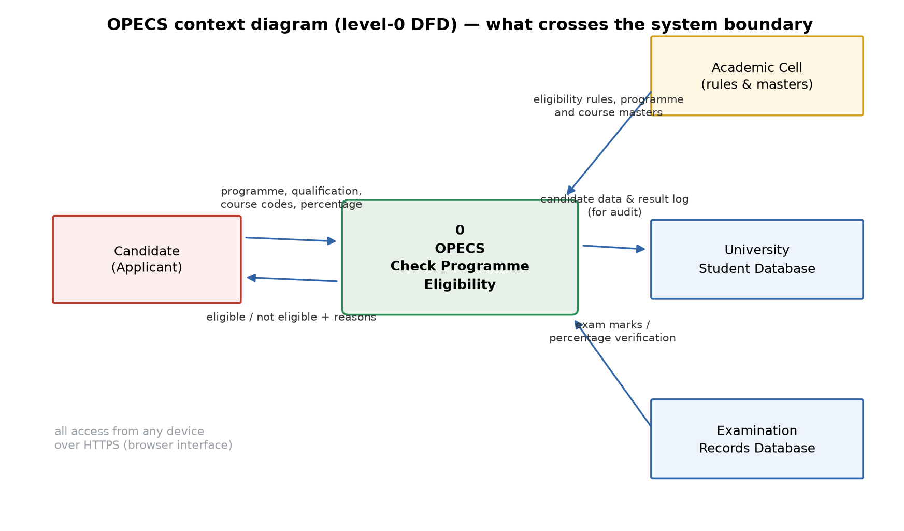
*🖼️ Figure 3 — OPECS level-0 context diagram. The single process is the whole system; every arrow crossing the boundary becomes an external interface or a functional requirement. The full level-1 DFD is drawn in Q1(e).*

## ⚠️ Before you move on — traps and self-check

**Traps**
1. Mixing the two lists: “the system shall show the result in 3 s” is **non**-functional; “the system shall show the result” is functional.
2. Writing NFRs with no metric (“should be fast”, “should be user-friendly”) — unmeasurable, therefore untestable.
3. Sneaking design into requirements (“use MySQL, make a 3-tier app”) — the SRS says what, the design says how; the only design statements allowed are imposed *constraints*.
4. Forgetting priorities — with 10 FRs and a fixed deadline, the mandatory ones must be separable from the desirable ones.
5. Treating the context diagram as a design — it is a boundary model; boxes inside it are *not* modules.

**Self-check**

| Question | Answer |
|---|---|
| FR or NFR: “the candidate can select multiple Course Codes” | FR |
| FR or NFR: “99.5 % uptime during admissions” | NFR (availability) |
| IEEE 610.12 definition of requirement? | a condition/capability needed by a user or required of a system, and its documented form |
| Output of requirements analysis? | the SRS; the wider RE process also produces the RDD |
| Four gathering tools? | record review, on-site observation, interview, questionnaire |

## 🧪 Exam trail — requirements topics in past MCS-213 TEE papers

| Session | Q | Marks | What was asked | Link to this part | Status |
|---|---|---|---|---|---|
| Jun-2026 | 1(b) | 10 | Principles of requirements analysis + challenges in gathering | ⭐ exactly this unit | ✅ answered below |
| Jun-2025 | 4(a) | 10 | Draw first 3 levels of DFD for a Railway Reservation System | needs full DFD rules — taught in Q1(e) L2 | ✅ answered in the Q1(e) TEE layer |
| Dec-2025 | 1(b) | 10 | Principles of software design / architectural design | — | ⏳ blocked — needs Unit 3 (Software Design) |

**Pattern:** requirements appear in **2 of 4** sessions as a theory question (principles + challenges) and once as a modelling question (DFD); nothing asks for a raw FR/NFR list, so the exam answer must *show the classification with examples*, as below.

## ✍️ Assignment answer (full version)

**📄 Question — MCS-213 assignment, p. 8, Q1(b) [15 marks]**
> Assume that you are assigned responsibility of developing an **Online Programme Eligibility Checking System (OPECS)** for a University. … *(full case quoted above)* … List the functional and non-functional requirements.

*No figure in this question.* **Assumptions:** eligibility rules are defined by the Academic Cell and stored as data; the candidate uses an ordinary browser; the system reads programme/qualification/course masters and (for verification) the examination records database; the result is advisory to the admission process.

**1. Functional requirements (what OPECS must do).** FR-01…FR-06 cover exactly the case's fields and the SUBMIT behaviour; FR-07…FR-10 are the supporting functions an operational web system needs. Priority: **M** = must be met, **S** = highly desirable.

| ID | Requirement | Priority |
|---|---|---|
| FR-01 | The system shall display the list of active programmes (code + title) and accept one **Programme Code** as input. | M |
| FR-02 | The system shall display the qualifications accepted for the chosen Programme Code and accept one **Qualification Code**. | M |
| FR-03 | The system shall display the courses that belong to the chosen qualification/Programme and allow **multiple Course Codes** to be selected. | M |
| FR-04 | The system shall accept the **Percentage** (nearest aggregate, 0–100 with up to two decimals) and reject non-numeric or out-of-range values. | M |
| FR-05 | On clicking **SUBMIT**, the system shall evaluate the candidate's qualification, chosen courses and percentage against the eligibility rules for the chosen Programme Code. | M |
| FR-06 | The system shall display the decision — **"Eligible"** or **"Not Eligible"** — with the programme title, the criteria applied and, when not eligible, the criterion that failed. | M |
| FR-07 | The system shall let the candidate change any input and re-submit without re-entering the other fields. | M |
| FR-08 | The system shall log every eligibility query (inputs, result, timestamp) for audit. | S |
| FR-09 | The Academic Cell shall be able to add/update programmes, qualifications, courses and eligibility rules through an authenticated maintenance module. | S |
| FR-10 | The system shall generate eligibility statistics per programme and qualification for admission planning. | S |

**2. Non-functional requirements (how well OPECS must do it).** Each is written with a measurable target and the condition under which it must hold.

| ID | Category | Requirement (measurable) |
|---|---|---|
| NFR-01 | Performance | 95 % of eligibility responses within **3 s** and none beyond 5 s, at **200 concurrent users** (peak 1 000 queries/hour during admissions). |
| NFR-02 | Availability | **≥ 99.5 %** uptime during the admission window (July–August); planned maintenance only outside it. |
| NFR-03 | Security | All traffic over **HTTPS/TLS**; role-based access (candidate / clerk / Academic Cell); hashed passwords; session timeout **15 min**; every result logged. |
| NFR-04 | Usability | A first-time candidate completes the form in **≤ 3 minutes** with no training; the result is at most **3 clicks** from the home page; works on a mobile browser. |
| NFR-05 | Scalability | Supports **all UG and PG programmes** of the university and 3× present query volume without architecture change. |
| NFR-06 | Reliability | **100 % correct** results for all valid rule combinations; fewer than 1 % erroneous logged queries (wrong user input excluded). |
| NFR-07 | Maintainability | Eligibility rules changeable through the rule table **without code change**; modular, documented code. |
| NFR-08 | Portability | Runs on current Chrome/Firefox/Edge/Safari browsers and on Windows or Linux servers. |
| NFR-09 | Backup & recovery | Daily backup; **recovery time ≤ 4 h** and recovery point ≤ 24 h after a failure. |

**3. How the two lists connect to the case.** FR-01…FR-05 are the five inputs and the SUBMIT action named in the case; FR-06 is the display the case demands; the rest make the system operable. The NFRs are not decoration: NFR-06 is what makes an eligibility system trustworthy, NFR-03 protects candidate data, and NFR-01/NFR-02 are what the admission rush actually tests.

**Hence** OPECS has 10 functional requirements (five of them the input fields/SUBMIT behaviour of the case) and 9 measurable non-functional requirements covering performance, availability, security, usability, scalability, reliability, maintainability, portability and backup.

## 📝 TEE layer — past-paper bank & coverage sweep

| Paper | Q | Marks | Concepts needed | Status |
|---|---|---|---|---|
| Jun-2026 | 1(b) | 10 | L0, L1 (RE, challenges) | ✅ answered below |
| Jun-2025 | 4(a) | 10 | DFD levels | ✅ answered in Q1(e) TEE layer |
| Dec-2025 | 1(b) | 10 | design principles | ⏳ blocked — needs Unit 3 |

### ✍️ TEE answer — Jun-2026, Q1(b) [10 marks]

**📄 Question — Jun-2026 TEE, Q1(b) [10 marks]**
> Discuss the principles of software requirements analysis and the challenges faced during the requirements gathering phase.

**Principles.** Requirements analysis identifies, defines and analyses what the system must do, and its output is the **SRS**. The principles that make it sound are:

1. **Understand the user's need before writing anything** — requirements are taken from the user, not invented by the developer; the user's objectives define the system.
2. **Use requirements engineering as a discipline** — systematic principles, techniques and language tools for cost-effective analysis, documentation and continuous evaluation of needs; separate **requirements definition** (gather → analyse/model → create RDD/SRS → review and validate with the user) from **requirements management** (track requirements, check complete implementation, control later changes).
3. **Classify and prioritise** — functional versus non-functional; must / highly desirable / eliminable, so that limited time and resources are spent in the right order.
4. **Make the SRS correct, consistent, unambiguous and complete**, with defined external interfaces, functional and non-functional requirements, and design constraints.
5. **Validate with the user** — a review and confirmation step, so that the document reflects reality, feeds design, and is feasible.
6. **Keep requirements traceable and change-controlled** — every later design/code element should trace back to a requirement, and changes must be managed rather than absorbed silently.

**Challenges during requirements gathering** (Block 1 U2 §2.2.4): (i) **complete requirements are hard to uncover** — automation makes it practically impossible to know everything at project start; (ii) **requirements keep being generated** — new needs appear when the system runs, but schedules are seldom adjusted; (iii) **over-dependence on CASE tools** can create false requirements; (iv) **tight schedules** cut the analysis phase and lead to disasters; (v) **communication is difficult** — users and developers have different vocabularies, backgrounds and psychology, and natural-language user statements must become precise specifications; (vi) **market-driven products** must first satisfy anonymous customers and then be customised; (vii) **resources may not cover all requirements**, so the customer must prioritise.

**Tools used to gather requirements** — record review, on-site observation, interviews and questionnaires — each chosen by what information is needed and from whom.

**Hence** requirements analysis is principled when it is user-driven, classified, validated and change-controlled, and its gathering phase is difficult mainly because requirements are incomplete, changing and communicated across an experience gap.

## ✅ Verification (Q1(b) block)

| Standard | Check | Result |
|---|---|---|
| Source-grounded | Requirement definition, RE branches, FR/NFR split, SRS qualities, gathering tools, challenges from Block 1 U2, pp. 562–578 | ✅ |
| Paraphrased (IGNOU rule) | Own wording; only definition-of-record phrasing quoted | ✅ |
| Structure | L0 → L1–L2 → traps/self-check → exam trail → 15-mark answer → TEE answer → verification | ✅ |
| Assignment answer | 2 requirement tables (10 FR + 9 NFR), every NFR measurable; ≈ 480 prose words → ~27–30 min handwritten | ✅ |
| Question-first | Verbatim part (b) + shared case quoted; TEE answer embeds its question | ✅ |
| Figures | Fig 3 (context diagram) referenced with numbered caption | ✅ |
| TEE layer | 1 answered standalone; DFD question cross-answered in Q1(e); design question blocked | ✅ |
| Registry | FR, NFR, RE, gathering tools, context diagram recorded with first-teaching location | ✅ |

# Q1(c) — Estimate cost (15 marks)
*Assignment p. 8 · Book: Block 2, Unit 5 “Software Project Planning”, pp. 608–620*

## 🧰 L0. Prerequisite bridge — the estimation vocabulary

| Term | Read it as | What it is & why it exists | Example |
|---|---|---|---|
| project metric | — | a quantitative measure of some attribute of the project; **primitive** metrics are directly observable, **derived** metrics combine them | primitive: LOC, defects; derived: LOC/man-month, defects/KLOC |
| size | — | how big the product is, measured in **LOC** (lines of code) or **FP** (function points) | OPECS ≈ 4.05 KLOC |
| effort | — | **person-months (PM)** — one person working for one month; effort is *not* time | 10.4 PM could be 2 people for ~5 months |
| schedule | — | calendar duration, obtained from effort and the people allocated: **Duration ≈ total man-months ÷ manpower** | 10.4 PM ÷ 2 ≈ 5.2 months of manpower |
| cost | — | money; the largest part is effort × the person-month rate, but hardware, travel, training, communication and contingency also count | ₹11.24 lakh for OPECS |
| estimate | — | a projection made before the facts are known, therefore carrying uncertainty (COCOMO's detailed model aims at ±20 %) | re-estimate after every phase |

The book's estimation chain (Block 2 U5 §5.3, pp. 612–615) is size → effort → schedule → cost, fed by user requirements, past-project data, organisational policies and schedule constraints:

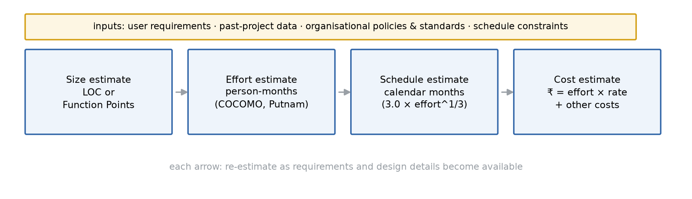
*🖼️ Figure 4 — The estimation pipeline of Block 2 U5: every later estimate depends on the size estimate, which is why estimating size is the most difficult first step.*

**Read aloud:** “First measure how big OPECS is, then convert size into person-months, then person-months into months, then months into rupees.”

## 🧮 L1. Size estimation — Function Point Analysis (Block 2 U5 §5.2, §5.4.4)

**Why not LOC alone.** The same module is 50 lines in COBOL but 20 lines in a 4GL; LOC penalises a well-designed short program and cannot be counted before the design exists. A **function point (FP)** measures the *functionality* the user receives, independently of language and technology, and can be counted right after requirements.

FPA was developed by **Allan J. Albrecht** (1970s). It counts five component types:

| Component | Read it as | Meaning | OPECS example |
|---|---|---|---|
| **EI** | external input | a process by which data crosses into the system and is used to maintain data | candidate submitting the eligibility form |
| **EO** | external output | a process by which data crosses out of the system | the eligibility result screen |
| **EQ** | external inquiry | an input + output that retrieves data (a lookup) | fetching the programme/qualification/course lists |
| **ILF** | internal logical file | a logically related data group maintained **inside** the application | programme master |
| **EIF** | external interface file | a data group **referenced but maintained outside** the application | examination records database |

Each component gets a complexity (low / medium / high), and the weights come from the book's tables:

| Component type | Low | Medium | High |
|---|---|---|---|
| External output (EO) | 4 | 6 | 8 |
| External input (EI) | 2 | 4 | 6 |
| External inquiry (EQ) | 3 | 5 | 7 |
| Internal logical file (ILF) | 6 | 8 | 10 |
| External interface file (EIF) | 5 | 7 | 9 |

**UFP** = Σ (count × weight). The 14 **general system characteristics (GSCs)** — data communications, performance, transaction rate, online data entry, complex processing, reusability, ease of change, etc. — are then rated 0–5 and folded in through the **value adjustment factor** (the standard completion of Albrecht's method):

> **VAF = 0.65 + 0.01 × ΣFᵢ**  — read aloud: “0.65 plus one per cent for every GSC point”
> **FP = UFP × VAF**

Derived metrics: **productivity = FP ÷ person-month**, **quality = defects ÷ FP**.

## 🧮 L2. From size to effort and cost (Block 2 U5 §5.3–5.4, pp. 612–619)

**COCOMO** — **Co**nstructive **Co**st **Mo**del, by Barry Boehm. Three levels:

| Level | Uses |
|---|---|
| Basic | software size only (LOC) |
| Intermediate | size + a set of **15 cost drivers** (database size, complexity, reliability requirements, performance constraints, engineer capability, schedule constraints, …) |
| Detailed | intermediate + cost implication of each development step (analysis, design, testing, …) |

Three project classes: **organic** (small, experienced team, familiar application), **semi-detached** (intermediate, rigid/semi-rigid requirements), **embedded** (developed under tight hardware, software and operational constraints). The effort equation is **E = a·S^b·m**, read aloud: “effort equals a times size to the power b, times the cost-driver multiplier”; S is in **KLOC** (thousands of lines of code). Development time follows **D = c·E^d**:

| Class | a | b | c | d |
|---|---|---|---|---|
| Organic | 2.4 | 1.05 | 2.5 | 0.38 |
| Semi-detached | 3.0 | 1.12 | 2.5 | 0.35 |
| Embedded | 3.6 | 1.20 | 2.5 | 0.32 |

For **basic** COCOMO the multiplier is m = 1; the intermediate model sets m from the 15 cost drivers.

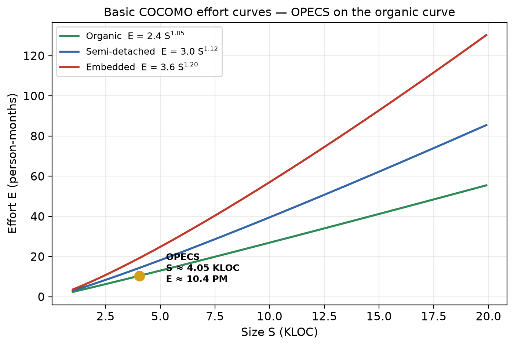
*🖼️ Figure 5 — Basic COCOMO effort curves. OPECS (S ≈ 4.05 KLOC) sits on the organic curve at E ≈ 10.4 person-months; the same size would cost ~13 PM semi-detached and ~17 PM embedded — the class is a real decision, not a label.*

**Putnam's model** (dealt with fully in Q1(d)'s TEE layer): a dynamic multivariate model that assumes effort follows the **Rayleigh–Norden curve**; it links delivered size S, life-cycle effort K (man-years) and development time T through S = Ck·K^(1/3)·T^(4/3). The **statistical (Walston–Felix) model** is a curve fitted to past projects, E = 5.2·L^0.91.

**Cost** (Block 2 U5 §5.3.4): project cost = effort cost **+** hardware cost **+** travel expenses **+** telecommunication cost **+** training cost **+** other cost factors. Accuracy depends on the quality of historical data, the accuracy of the inputs and the maturity of the organisation's process; estimates are re-done as the project progresses.

## ⚠️ Before you move on — traps and self-check

**Traps**
1. Using LOC where the question says “size in function points”, or vice versa — FP and KLOC are different units.
2. Feeding **LOC** into COCOMO instead of **KLOC** (a factor-of-1000 error).
3. Writing E = 2.4·S^1.05 as if it included the cost drivers — that is *basic* COCOMO (m = 1); intermediate multiplies by m.
4. Confusing **effort** (10.4 PM) with **schedule** (6.1 months) — the same effort can take very different calendar time depending on team size.
5. Reporting only effort cost as “project cost” — hardware, training, travel and contingency are part of the answer.
6. Rounding mid-calculation: keep the decimals, round only the final money figures.

**Self-check**

| Question | Answer |
|---|---|
| UFP of two medium EIs and one low EO? | 2×4 + 1×4 = 12 |
| VAF when ΣFᵢ = 46? | 0.65 + 0.46 = 1.11 |
| OPECS effort estimate? | 2.4 × 4.05^1.05 ≈ **10.4 PM** |
| OPECS schedule estimate? | 2.5 × 10.4^0.38 ≈ **6.1 months** |
| Team size? | 10.4 ÷ 6.1 ≈ **1.7 → 2 people** |

## 🧪 Exam trail — cost/effort estimation in past MCS-213 TEE papers

| Session | Q | Marks | What was asked | Link to this part | Status |
|---|---|---|---|---|---|
| Dec-2025 | 3(a) | 10 | Software project management + COCOMO | ⭐ COCOMO (L2) | ✅ answered below |
| Jun-2025 | 4(b) | 10 | COCOMO model of cost estimation | ⭐ COCOMO (L2) | ✅ answered below |
| Jun-2026 | 3(a) | 10 | Cost estimation + Function Point Analysis | ⭐ FPA (L1) | ✅ answered below |
| Dec-2024 | 1(b) | 10 | Putnam's model for estimation | ☆ needs Putnam (L2) | ✅ answered in Q1(d) TEE layer |

**Pattern:** estimation is asked in **4 of 4** sessions — always 10 marks, always “explain the model” (COCOMO twice, FPA once, Putnam once); OPECS's own numbers double as the example in every answer.

## ✍️ Assignment answer (full version)

**📄 Question — MCS-213 assignment, p. 8, Q1(c) [15 marks]**
> Assume that you are assigned responsibility of developing an **Online Programme Eligibility Checking System (OPECS)** for a University. … *(full case quoted above)* … Estimate cost.

*No figure in this question.* **Assumptions** (stated, as the case invites): the project is an **organic** one (medium web system, experienced in-house team, familiar admission domain); Java/web stack at **50 LOC per FP**; blended internal rate **₹80,000 per person-month**; figures are 2026 Indian rupees; basic COCOMO is used with an intermediate-model check.

**Step 1 — Estimate size by Function Point Analysis.**

| Type | Component (OPECS) | Complexity | Weight | UFP |
|---|---|---|---|---|
| EI | Candidate eligibility query (SUBMIT) | Medium | 4 | 4 |
| EI | Candidate registration / login | Low | 2 | 2 |
| EI | Academic Cell rule & master maintenance | High | 6 | 6 |
| EO | Eligibility result display | Medium | 6 | 6 |
| EO | Ineligibility detail report | Low | 4 | 4 |
| EQ | Programme list lookup | Low | 3 | 3 |
| EQ | Qualification list lookup | Low | 3 | 3 |
| EQ | Course list lookup (multi-select) | Medium | 5 | 5 |
| ILF | Programme master | Low | 6 | 6 |
| ILF | Qualification master | Low | 6 | 6 |
| ILF | Course master | Low | 6 | 6 |
| ILF | Candidate / application records | Medium | 8 | 8 |
| EIF | Eligibility rule base (Academic Cell) | Medium | 7 | 7 |
| EIF | Student / examination records database | Medium | 7 | 7 |
| | | | **UFP** | **73** |

The 14 general system characteristics rate as: 3, 3, 4, 2, 4, 5, 4, 3, 4, 3, 2, 3, 2, 4 → **ΣFᵢ = 46**.
> VAF = 0.65 + 0.01 × 46 = **1.11**  →  FP = 73 × 1.11 = **81.03 ≈ 81 FP**

Converting to code size at 50 LOC/FP: 81 × 50 = 4 050 LOC = **4.05 KLOC**.

**Step 2 — Estimate effort with basic COCOMO (organic).**
> E = 2.4 × S^1.05 = 2.4 × (4.05)^1.05
> ln 4.05 = 1.3987 → × 1.05 = 1.4686 → e^1.4686 = 4.343
> E = 2.4 × 4.343 = **10.42 ≈ 10.4 person-months**

**Step 3 — Estimate schedule.**
> D = 2.5 × E^0.38 = 2.5 × (10.42)^0.38
> ln 10.42 = 2.3440 → × 0.38 = 0.8907 → e^0.8907 = 2.437
> D = 2.5 × 2.437 = **6.09 ≈ 6.1 months**  → team = 10.42 ÷ 6.09 ≈ **1.7 ≈ 2 persons**

**Step 4 — Estimate cost.**

| Cost item | Basis | Amount (₹) |
|---|---|---|
| Effort cost | 10.4 PM × ₹80,000/PM | 8,32,000 |
| Server, hosting, domain & SSL (year 1) | lumpsum | 70,000 |
| Middleware / tool licences | lumpsum | 40,000 |
| Training of admission staff | 2 sessions | 50,000 |
| Travel & communication | lumpsum | 30,000 |
| **Subtotal** | | **10,22,000** |
| Contingency (risk buffer) | 10 % of subtotal | 1,02,200 |
| **Total estimated cost** | | **≈ ₹11,24,200** |

Cross-check by the schedule formula: 3.0 × (10.4)^(1/3) = 3.0 × 2.18 ≈ **6.6 months** — consistent with 6.1 months. Unit cost: ₹11.24 lakh ÷ 81 FP ≈ **₹13,900 per function point**.

**Hence the estimated cost of OPECS is approximately ₹11.25 lakh (11,24,200), built from 81 function points ≈ 4.05 KLOC, 10.4 person-months of effort over about 6.1 months by a team of two.** COCOMO's ±20 % accuracy gives a planning range of roughly **₹9.0 lakh to ₹13.5 lakh**, to be re-estimated after design.

## 📝 TEE layer — past-paper bank & coverage sweep

| Paper | Q | Marks | Concepts needed | Status |
|---|---|---|---|---|
| Dec-2025 | 3(a) | 10 | SPM definition + COCOMO levels/classes/equations | ✅ answered below |
| Jun-2025 | 4(b) | 10 | COCOMO model | ✅ answered below |
| Jun-2026 | 3(a) | 10 | cost estimation + FPA | ✅ answered below |
| Dec-2024 | 1(b) | 10 | Putnam | ✅ answered in Q1(d) TEE layer |

### ✍️ TEE answer — Dec-2025, Q3(a) [10 marks]

**📄 Question — Dec-2025 TEE, Q3(a) [10 marks]**
> Define Software Project Management. Explain the COCOMO Model for software project cost estimation.

**Software project management (SPM)** is the process of planning, organising, staffing, directing and controlling a software project so that it is delivered **on time, within budget and at the required quality**. It covers the people, the product, the process and the project, and its core activities are estimation (size, effort, cost, schedule), scheduling, risk management, quality management and change management. Because software projects historically overshoot schedule and cost, the project manager's responsibility is to make as accurate an estimate of effort and cost as possible; under-staffing lowers quality and misses deadlines, while over-staffing raises cost.

**COCOMO (Constructive Cost Model)**, introduced by **Barry Boehm**, is the best-known and most thoroughly documented cost-estimation model. It assumes effort depends on **size** — measured in thousands of delivered lines of code (KLOC) — and offers three levels: **basic** (size only), **intermediate** (size + 15 cost drivers such as complexity, reliability, run-time performance, engineer capability, schedule constraints) and **detailed** (intermediate + cost implication at each development step). It also classifies projects as **organic** (small, experienced team), **semi-detached** (intermediate, semi-rigid requirements) and **embedded** (tight hardware/software/operational constraints).

The estimating equations are:
> **E = a · S^b · m**   and   **D = c · E^d**
> E = effort in person-months, S = size in KLOC, m = cost-driver multiplier (m = 1 for basic COCOMO), D = development time in months.

| Class | a | b | c | d |
|---|---|---|---|---|
| Organic | 2.4 | 1.05 | 2.5 | 0.38 |
| Semi-detached | 3.0 | 1.12 | 2.5 | 0.35 |
| Embedded | 3.6 | 1.20 | 2.5 | 0.32 |

**Example.** A 4.05-KLOC organic project: E = 2.4 × 4.05^1.05 ≈ 10.4 PM; D = 2.5 × 10.4^0.38 ≈ 6.1 months; with a rate of ₹80,000 per person-month the effort cost is about ₹8.3 lakh. Boehm claims the detailed model is accurate to about **±20 %** of the actual value.

**Hence** SPM is the management discipline that delivers software on time/cost/quality, and COCOMO estimates its effort and hence cost from size using project class, model level and (in the intermediate model) cost drivers.

### ✍️ TEE answer — Jun-2025, Q4(b) [10 marks]

**📄 Question — Jun-2025 TEE, Q4(b) [10 marks]**
> Explain the COCOMO model of cost estimation.

**Need.** Cost estimation predicts a project's cost from its size and effort; algorithmic models like COCOMO make the prediction repeatable. **COCOMO** (**Co**nstructive **Co**st **Mo**del) was introduced by **Barry Boehm** and remains the best-known and most thoroughly documented software cost model.

**Model levels.** (1) **Basic COCOMO** — a single-value model computing cost as a function of estimated LOC. (2) **Intermediate COCOMO** — development cost and effort as a function of program size *and* a set of 15 cost-driver attributes (examples: size of the application database, project complexity, reliability requirements, run-time performance constraints, capability of the software engineer, schedule constraints). (3) **Detailed COCOMO** — intermediate features plus the cost implication of each development step (analysis, design, coding, testing).

**Project classes.** **Organic** — small project with an experienced team; **semi-detached** — intermediate size with rigid and semi-rigid requirements; **embedded** — developed under tight hardware, software and operational constraints (embedded software, flight control).

**Equations.** Effort **E = a·S^b·m** and development time **D = c·E^d**, where S is source size in **KLOC** and m is the cost-driver multiplier from the 15 attributes (m = 1 in the basic model):

| Class | a | b | c | d |
|---|---|---|---|---|
| Organic | 2.4 | 1.05 | 2.5 | 0.38 |
| Semi-detached | 3.0 | 1.12 | 2.5 | 0.35 |
| Embedded | 3.6 | 1.20 | 2.5 | 0.32 |

**Worked example (organic, S = 10 KLOC):** E = 2.4 × 10^1.05 = 2.4 × 11.22 ≈ 26.9 PM; D = 2.5 × 26.9^0.38 ≈ 2.5 × 3.50 ≈ 8.8 months. Boehm states the detailed model estimates to ±20 % of the actual value.

**Hence** COCOMO converts estimated size into effort, schedule and cost through its three levels and three project classes, with cost drivers refining the estimate at the intermediate/detailed level.

### ✍️ TEE answer — Jun-2026, Q3(a) [10 marks]

**📄 Question — Jun-2026 TEE, Q3(a) [10 marks]**
> Define software project cost estimation. Explain the Function Point Analysis (FPA) method for estimating software project size.

**Software project cost estimation** is the process of predicting the total cost of developing a software project from its estimated **size** and **effort**, together with the other cost factors — hardware, travel, telecommunication, training and similar expenses. It follows the estimation chain size → effort → schedule → cost, is crucial for bidding and for management's go/no-go decision, and always carries uncertainty because software size is hard to predict early.

**Function Point Analysis (FPA)**, developed by **Allan J. Albrecht** in the 1970s, measures the **functionality** delivered to the user rather than lines of code, so the count is independent of language, technology and development method and can be made from the requirements itself. It counts five component types:

| Component | Meaning |
|---|---|
| External input (EI) | data crossing into the system to update files |
| External output (EO) | data crossing out of the system (report, screen) |
| External inquiry (EQ) | input + output that retrieves data |
| Internal logical file (ILF) | logically related data maintained inside the application |
| External interface file (EIF) | data referenced but maintained outside the application |

Each component is rated low/medium/high complexity and weighted: EO 4/6/8, EI 2/4/6, EQ 3/5/7, ILF 6/8/10, EIF 5/7/9. Their weighted sum is the **unadjusted function point count, UFP**. The 14 general system characteristics (data communications, performance, transaction rate, online data entry, complex processing, reusability, ease of change, …) are then rated 0–5 and applied through the **value adjustment factor**:
> **FP = UFP × (0.65 + 0.01 × ΣFᵢ)**

**Example.** A system with EI = 3 medium (12), EO = 2 medium (12), EQ = 1 low (3), ILF = 2 low (12) gives UFP = 39; if ΣFᵢ = 42, FP = 39 × (0.65 + 0.42) = 39 × 1.07 ≈ 41.7 ≈ 42 function points. Derived metrics: productivity = FP per person-month, quality = defects per FP.

**Benefits:** size can be estimated early from user-visible functions, the same count holds across technologies, and FPs track and monitor the project across its stages. **Hence** FPA converts a functional description into a language-independent size measure, on which effort and cost models can then operate.

## ✅ Verification (Q1(c) block)

| Standard | Check | Result |
|---|---|---|
| Source-grounded | Metrics, FPA components/weights/derived metrics, COCOMO levels/classes/equations, Putnam/statistical models, cost components from Block 2 U5, pp. 608–620 | ✅ |
| Paraphrased (IGNOU rule) | Own wording; weight and coefficient tables reproduced as data of record | ✅ |
| Structure | L0 → L1–L2 → traps/self-check → exam trail → 15-mark numeric answer → 3 TEE answers → verification | ✅ |
| Assignment answer | 4 steps + 3 tables, every substitution shown, **₹11.24 lakh** bolded; ≈ 520 prose words + tables → ~30–35 min handwritten | ✅ |
| Numbers verified | UFP 73; ΣFᵢ 46 → VAF 1.11 → 81.03 FP; 4.05 KLOC; E = 10.42 PM; D = 6.09 months; cost 10,22,000 + 1,02,200 = 11,24,200; cross-check 6.6 months | ✅ |
| Symbol standard | VAF, E, D, S, m, PM, UFP, FP, KLOC each read aloud with purpose and example | ✅ |
| Question-first | Verbatim part (c) + shared case; all TEE answers embed their questions | ✅ |
| Figures | Figs 4–5 referenced with numbered captions | ✅ |
| TEE layer | 3 answered standalone at paper marks; Putnam cross-answered in Q1(d) | ✅ |

# Q1(d) — Estimate efforts (15 marks)
*Assignment p. 8 · Book: Block 2, Unit 5 “Software Project Planning”, pp. 608–620*

## 🧰 L0. Prerequisite bridge — effort is people × time

| Term | Read it as | What it is & why it exists | Example |
|---|---|---|---|
| effort | — | the total human work, measured in **person-months (PM)** or person-hours; effort is a *quantity of work*, not a duration | 10.4 PM |
| productivity | — | how much product one person-month yields; **size ÷ effort** | 81 FP ÷ 10.4 PM ≈ 7.8 FP/PM |
| staffing / manpower | — | how many people are on the project at a given time; schedule = effort ÷ manpower | 10.4 PM ÷ 2 ≈ 5 months of manpower |
| effort estimation | — | predicting effort from the estimated size (and past data/models) — the step between size and schedule/cost | the subject of this part |
| phase distribution | — | the percentage of effort spent in each life-cycle phase; the shape of the staffing over time | 10 % requirements, 20 % design, 40 % coding, 30 % testing |
| contingency / buffer | — | extra effort kept aside for risks and rework | 10–20 % of the estimate |

**One unit-level warning that decides this answer** (Block 1 U1 §1.2, p. 547): “more manpower can be added to speed up development” is listed as a *common misunderstanding* — software is built by well-coordinated teams, and a person joining late needs extra effort just to understand the code. Effort therefore cannot be reduced by simply adding people; the 40 % coding share below is planned, not improvised.

**Read aloud:** “How many person-months of work will OPECS take, and how will those person-months be spread over the phases and over the team?”

## 📊 L1. The five ways to estimate effort (Block 2 U5 §5.3.2, pp. 613–614)

The book's first rule is that the **best basis is the organisation's own historical data** from similar projects, because the organisation follows a similar life cycle each time. When the project is different, an algorithm-based model is used. The recognised techniques:

| Method | How it works | Best when | OPECS use |
|---|---|---|---|
| Historical / organisational data | use measured effort from past similar projects | the organisation has records | university IT cell's last web project |
| Estimation by analogy | scale a past project by size/complexity ratios | a close analogy exists | previous admission portal |
| Decomposition (functionality) | split the system into subsystems, size and estimate each, then add | the work breakdown is known | 5 modules: UI, rule engine, masters, admin, reports |
| Algorithmic models | COCOMO, Putnam, statistical model — effort = f(size) | no close history; a defensible number is needed | **basic COCOMO, organic** |
| Expert judgement / Delphi | several experts estimate independently, then reconcile | novelty is high, data scarce | sanity-check the model output |

Any method ends with the same three numbers: **effort (PM) → schedule (months) → staff (persons)**.

## 🕒 L2. Spreading the effort over the life cycle

The total effort is not spent uniformly. A widely used planning split for a small/medium project is:

| Phase | Share of effort | OPECS (of 10.4 PM) |
|---|---|---|
| Plans & requirements | 10 % | 1.0 PM |
| Design | 20 % | 2.1 PM |
| Coding & unit testing | 40 % | 4.2 PM |
| Integration & system testing | 30 % | 3.1 PM |
| **Total** | **100 %** | **10.4 PM** |

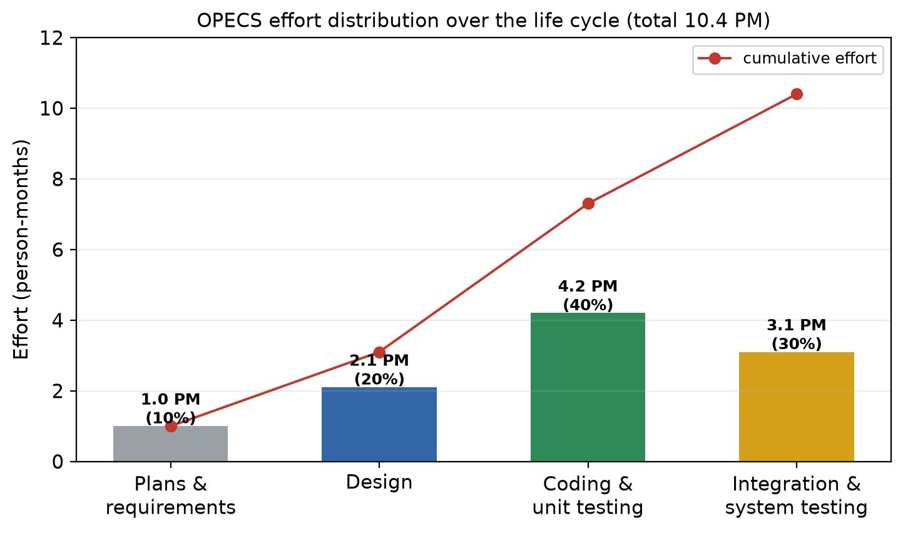
*🖼️ Figure 6 — OPECS effort by phase (10/20/40/30) with the cumulative curve. The last 30 % is where integration defects are found — planning it away is the classic estimation mistake.*

Putnam's **Rayleigh–Norden curve** explains *why* staffing is not constant: the number of people rises to a peak around the scheduled development time and then falls away as the product stabilises.

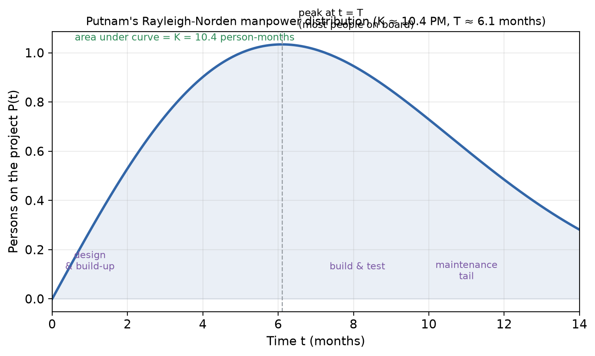
*🖼️ Figure 7 — Rayleigh–Norden manpower distribution for K ≈ 10.4 person-months over T ≈ 6.1 months: area under the curve = total effort; staffing peaks near T and tapers into maintenance (Block 2 U5 §5.4.2).*

Staffing is derived, never guessed: **persons ≈ phase effort ÷ phase duration**, and the team size must stay near the average **total effort ÷ total duration = 10.4 ÷ 6.1 ≈ 1.7 persons**, rising only for the testing peak.

## ⚠️ Before you move on — traps and self-check

**Traps**
1. Writing “effort = 6 months” — 6 months is the *schedule*; effort is 10.4 **person-months**.
2. Dividing effort by the calendar months and forgetting the unit: 10.4 PM ÷ 6.1 months ≈ 1.7 **persons**, not 1.7 months.
3. Planning only the 40 % coding block — requirements, design and testing are 60 % of the effort.
4. Ignoring contingency: a single-point estimate with no buffer turns every risk into a delay.
5. Forgetting re-estimation: effort estimates are revised after requirements and after design, when the size is better known.

**Self-check**

| Question | Answer |
|---|---|
| OPECS effort from COCOMO? | 10.42 ≈ **10.4 PM** |
| Effort in the coding phase? | 40 % × 10.4 = **4.2 PM** |
| Schedule for 10.4 PM with 2 people? | 10.4 ÷ 2 ≈ **5.2 months** (COCOMO's D gives 6.1 with ramp-up/ramp-down) |
| Productivity with 81 FP and 10.4 PM? | ≈ **7.8 FP/PM** |
| Why can't four people finish twice as fast? | coordination and code-understanding overhead; new members need extra effort (book's crisis list) |

## 🧪 Exam trail — effort/schedule estimation in past MCS-213 TEE papers

| Session | Q | Marks | What was asked | Link to this part | Status |
|---|---|---|---|---|---|
| Dec-2024 | 1(b) | 10 | Explain Putnam's model for estimation | ☆ effort model (Putnam, Q1(c) L2) | ✅ answered below |
| Dec-2025 | 1(d) | 10 | Process of project scheduling + two scheduling tools | — | ⏳ blocked — needs Unit 6 (scheduling, Gantt/PERT) |
| Dec-2025 | 3(a) | 10 | SPM + COCOMO | effort model basics | ✅ answered in Q1(c) TEE layer |

**Pattern:** the unit's effort models appear in **2 of 4** sessions (COCOMO twice, Putnam once counting Dec-2024); scheduling *tools* are asked once but need Unit 6, so they stay blocked.

## ✍️ Assignment answer (full version)

**📄 Question — MCS-213 assignment, p. 8, Q1(d) [15 marks]**
> Assume that you are assigned responsibility of developing an **Online Programme Eligibility Checking System (OPECS)** for a University. … *(full case quoted above)* … Estimate efforts.

*No figure in this question.* **Assumptions:** size from Q1(c) — **81 function points ≈ 4.05 KLOC**; organic project; organisational productivity ≈ **8 FP/person-month** (used as the historical-data cross-check); 10/20/40/30 life-cycle split; COCOMO scheduled time D from the organic coefficients; means are 2026 quantities.

**1. Method.** Effort is estimated in **person-months** from the estimated size. This answer uses **basic COCOMO (organic)** as the primary model — because a different-from-routine project justifies an algorithmic approach when history is thin — and cross-checks it against the organisation's productivity data, which the unit regards as the best basis.

**2. Effort from COCOMO.**
> E = 2.4 × S^1.05 = 2.4 × (4.05)^1.05 = 2.4 × 4.343 = **10.42 ≈ 10.4 person-months**

Cross-check with productivity: 81 FP ÷ 8 FP/PM = **10.1 PM** — within 3 % of the COCOMO figure, so 10.4 PM is accepted.

**3. Schedule and team.**
> D = 2.5 × E^0.38 = 2.5 × 10.42^0.38 = 2.5 × 2.437 = **6.09 ≈ 6.1 months**
> Average team = 10.42 ÷ 6.09 ≈ **1.7 ≈ 2 persons**  (a small in-house team, as the incremental paradigm assumes)

**4. Phase-wise effort distribution and staffing.**

| Phase | Share | Effort (PM) | Indicative duration | Average staffing |
|---|---|---|---|---|
| Plans & requirements | 10 % | 1.0 | 0.7 month | 1.4 |
| Design | 20 % | 2.1 | 1.4 months | 1.5 |
| Coding & unit testing | 40 % | 4.2 | 2.6 months | 1.6 |
| Integration & system testing | 30 % | 3.1 | 1.4 months | 2.2 |
| **Total** | **100 %** | **10.4** | **6.1 months** | **1.7** |

Staffing follows the Rayleigh-Norden shape: one analyst + part-time project manager during requirements, two developers through design and coding, and a peak of about three persons (developers + the admission officer doing acceptance tests) during integration testing. No phase is planned with more people than can be coordinated — the unit's warning against “adding manpower to speed up development” is respected.

**5. Uncertainty.** COCOMO's detailed accuracy is ±20 %, and the productivity cross-check already agrees within 3 %, so the planning band is **8.3 – 12.5 person-months**; a **1.5-PM contingency** is reserved inside the upper end for rule changes and rework.

**Hence the estimated effort for OPECS is 10.4 person-months, spread over a 6.1-month schedule as 1.0 PM requirements, 2.1 PM design, 4.2 PM coding/unit testing and 3.1 PM integration/system testing, with an average team of two persons (peak three) and a ±20 % planning range of 8.3–12.5 person-months.**

## 📝 TEE layer — past-paper bank & coverage sweep

| Paper | Q | Marks | Concepts needed | Status |
|---|---|---|---|---|
| Dec-2024 | 1(b) | 10 | Putnam model; Rayleigh-Norden curve | ✅ answered below |
| Dec-2025 | 1(d) | 10 | scheduling process + Gantt/PERT | ⏳ blocked — needs Unit 6 |

### ✍️ TEE answer — Dec-2024, Q1(b) [10 marks]

**📄 Question — Dec-2024 TEE, Q1(b) [10 marks]**
> Explain Putnam's model for estimation.

**What it is.** L. H. **Putnam** developed a **dynamic multivariate model** of the software development process. Its central assumption is that the distribution of effort (manpower) over the life of a project follows the **Rayleigh–Norden curve** — manpower starts low, rises to a peak at the planned development time T, then falls away into maintenance.

**The manpower equation.**
> P(t) = K · t · e^(−t²⁄2T²) ÷ T²  … read aloud: “persons at time t equals K times t times e to the minus t-squared over two T-squared, all over T-squared”
> P = number of persons on the project at time t; **K** = area under the curve = **total life-cycle effort**; **T** = development time.

**The size equation.** From the curve, Putnam derived the relation between delivered size and effort/time:
> S = Ck · K^(1/3) · T^(4/3)
> S = delivered lines of source code (LOC); Ck = “state of technology” constant of the organisation; K = life-cycle effort in man-years; T = development time in years.

**What the model tells a manager.** (i) Total effort K is the area under the staffing curve — so the curve shows *when* people are needed, not just how many. (ii) Because T appears with exponent 4/3, **compressing the schedule increases the effort required much faster than proportionally**: there is a minimum feasible development time, and forcing a shorter one raises cost sharply (the time–cost trade-off). (iii) The peak staffing is P(T) = K·e^(−1/2)/T ≈ 0.61·K/T — for a 10.4 person-month project (K ≈ 0.87 man-years) with T ≈ 0.51 years, the peak is about 1 person, with the average over the window ≈ 1.7 persons because the curve has a tail.

**Example (OPECS).** K = 10.4 person-months ≈ 0.87 man-years, T = 6.1 months ≈ 0.51 years. The maintenance tail after T is a normal part of the life cycle, so maintenance must be budgeted. Distorting T (e.g. halving it for the admission deadline) would require much more than double the effort — exactly why the incremental delivery plan of Q1(a) protects the schedule instead of compressing it.

**Limitations.** The model needs a reliable size estimate, the development time T and the technology constant Ck; all three are uncertain early, so the output is only as good as its inputs. It models the *whole* life cycle and is best used with, not instead of, COCOMO-style sizing.

**Hence Putnam's model estimates effort, schedule and staffing together by assuming a Rayleigh–Norden manpower distribution, and its size equation S = Ck·K^(1/3)·T^(4/3) quantifies the cost of compressing the schedule.

## ✅ Verification (Q1(d) block)

| Standard | Check | Result |
|---|---|---|
| Source-grounded | Effort estimation and its bases, schedule relation, Putnam/Rayleigh-Norden equations, manpower warning from Block 2 U5/U1, pp. 608–620, 545–561 | ✅ |
| Paraphrased (IGNOU rule) | Own wording; equations reproduced as data of record | ✅ |
| Structure | L0 → L1–L2 → traps/self-check → exam trail → 15-mark answer → Putnam TEE answer → verification | ✅ |
| Assignment answer | 5 steps + 2 tables, every substitution shown, **10.4 PM / 6.1 months / team of 2** bolded; ≈ 480 prose words + tables → ~27–30 min handwritten | ✅ |
| Numbers verified | E = 10.42 PM; D = 6.09 months; 10.4 ÷ 6.1 = 1.7; 10/20/40/30 % → 1.0/2.1/4.2/3.1 PM; productivity cross-check 81/8 = 10.1 PM; ±20 % → 8.3–12.5 PM | ✅ |
| Symbol standard | E, D, PM, K, T, Ck, P(t) each read aloud with purpose and example | ✅ |
| Question-first | Verbatim part (d) + shared case; TEE answer embeds its question | ✅ |
| Figures | Figs 6–7 referenced with numbered captions | ✅ |
| TEE layer | Putnam answered standalone at paper marks; scheduling blocked with reason | ✅ |

# Q1(e) — Develop SRS using IEEE format (20 marks)
*Assignment p. 8 · Book: Block 1, Unit 2 “Principles of Software Requirements Analysis”, pp. 562–578 (SRS outline §2.2.3, DFD §2.3)*

## 🧰 L0. Prerequisite bridge — what the SRS is for

The **SRS (Software Requirements Specification)** is the document produced by requirements analysis. It is written in natural language and clearly defines (Block 1 U2 §2.2.3): the **external interfaces** of the system (what information flows to and from it), the **functional and non-functional requirements**, and the **design constraints**. Because it is the baseline from which design, code, tests and maintenance all derive, the SRS must be **correct, consistent, unambiguous and complete**.

| Reader | Uses the SRS to … |
|---|---|
| Customer / Academic Cell | confirm that the developer understood the need |
| Designer | derive the architecture and modules (SRS is the input to design) |
| Coder | get each module's specification |
| Tester | derive test cases — every requirement must be testable |
| Maintainer | know what the system was supposed to do before changing it |

The classic IEEE quality checklist for an SRS — the four book qualities plus the practical ones: **correct, unambiguous, complete, consistent, ranked for importance/stability, verifiable, modifiable, traceable**. Two writing rules follow from it: every requirement is **numbered and traceable**, and obligations are written with **“shall”** (“The system shall accept a percentage…”), never with vague words such as *etc., and/or, fast, user-friendly*.

**Read aloud:** “Write the full requirements document for OPECS in the standard IEEE section order, with every requirement numbered and testable.”

## 📐 L1. The IEEE-830 outline used by the unit

The unit prints the SRS outline reproduced below (Block 1 U2 §2.2.3, p. 564); it follows IEEE Std 830-1998 and is the format this answer must use.

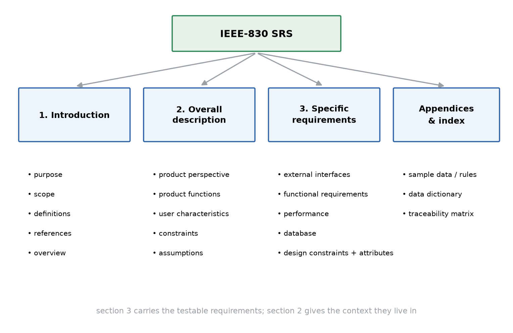
*🖼️ Figure 8 — The IEEE-830 SRS structure as printed in the unit: three numbered sections plus supporting information. Section 3 carries the testable requirements; section 2 gives the context they live in.*

| Section | Sub-sections | What goes in |
|---|---|---|
| **1. Introduction** | 1.1 Purpose · 1.2 Scope · 1.3 Definitions, acronyms, abbreviations · 1.4 References · 1.5 Overview | why the document exists, what product it covers, the vocabulary, the documents it builds on, how the rest is organised |
| **2. Overall description** | 2.1 Product perspective · 2.2 Product functions · 2.3 User characteristics · 2.4 Constraints · 2.5 Assumptions and dependencies | the product in its environment (context diagram), the summary of functions, who the users are, what limits the product, what is taken for granted |
| **3. Specific requirements** | 3.1 External interfaces · 3.2 Functional requirements · 3.3 Performance requirements · 3.4 Logical database requirements · 3.5 Design constraints · 3.6 Software system attributes · 3.7 Organising the specific requirements · 3.8 Additional comments | the numbered, testable requirements themselves |
| **4. Supporting information** | 4.1 Table of contents and index · 4.2 Appendices | navigation aids and supporting material (sample data, models, traceability) |

The litmus test for every line: **section 3 must be verifiable** — a tester should be able to decide pass/fail from the SRS alone. Section 2 is allowed to describe; section 3 is not.

## 🗺️ L2. The modelling tools that feed sections 2 and 3 (Block 1 U2 §2.3)

**Data Flow Diagram (DFD)** — a graphical representation of the flow of data through a system, pictured as a network of functional processes. Four symbols:

| Symbol | Name | Meaning |
|---|---|---|
| → | data flow | connectivity between processes: data in motion |
| ○ / ⬭ | process | performs some processing of input data |
| ▭ | external entity | source or destination of system data (receives or supplies information) |
| ▬▬ | data store | repository of data |

DFDs are built in **layers**: the **level-0 DFD** views the whole system as a single bubble with only its inputs and outputs — it is the **context diagram**; level 1 explodes the single bubble into the main processes; each further level refines one process. **Rules for making DFDs** (Block 1 U2 §2.3.3): note all processes and external entities and give them **unique names**; **number** the processes (1.0, 2.0, 2.1 …); keep the diagram simple; keep it **internally consistent**; every process must have **at least one input and one output**; and the data store must contain all the data elements that flow as its inputs and outputs.

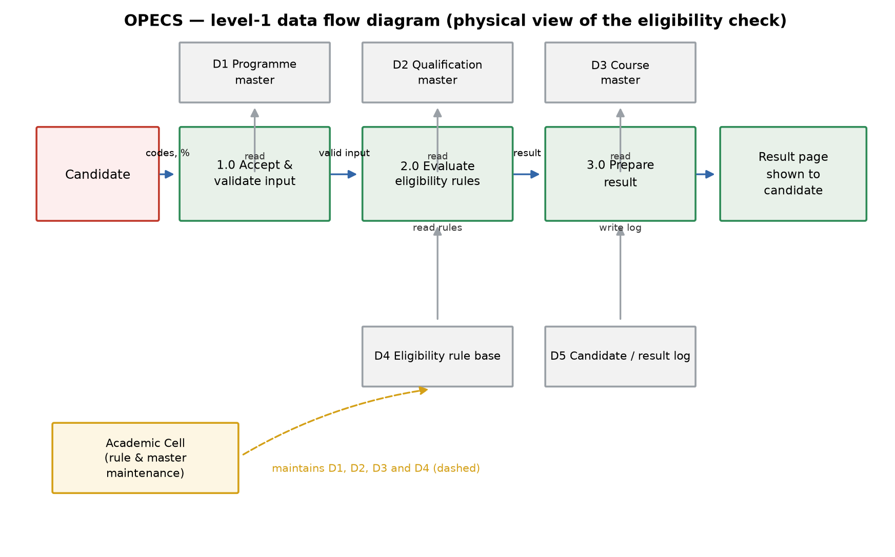
*🖼️ Figure 9 — OPECS level-1 DFD: the level-0 bubble of Figure 3 exploded into validate → evaluate → prepare-result, with the masters, the rule base and the result log as data stores. This diagram is Appendix B of the SRS below.*

**Data dictionary** — a catalogue of every element of the system that *reduces the complexity of the DFD*: for each data item it stores the name (e.g. *course opted* = CO), attribute type, size, related data items, range of values and the data-structure definition. Notation examples: `X = [a/b]` (X is either a or b), `X = a` (a is optional), `X = a + b` (X is a followed by b).

**E-R diagram** — the detailed logical, **data-oriented** model of the organisation: entities, their relationships and attributes. It shows data at rest, whereas the DFD tracks data in motion; the two complement each other. The E-R content of OPECS appears in section 3.4 of the SRS.

## ⚠️ Before you move on — traps and self-check

**Traps**
1. Writing design into the SRS (“use MySQL with three tables”) — only *imposed* constraints belong there (e.g. “must reuse the university's existing database”).
2. Leaving section 3 vague (“the system should be secure”) instead of testable (“all traffic over HTTPS/TLS 1.2+, sessions time out after 15 minutes”).
3. Omitting whole sections — external interfaces, performance, database and attributes are the most-forgotten.
4. Unnumbered requirements: nothing can be traced to design or tests.
5. DFD rule violations: a process with only inputs (black hole) or only outputs (miracle); crossing lines; unnamed stores; the same store as external entity and internal store.
6. Forgetting the context diagram: level 0 must contain exactly one process bubble.

**Self-check**

| Question | Answer |
|---|---|
| Which SRS section holds the numbered functional requirements? | 3.2 (section 3, specific requirements) |
| Level-0 DFD is also called? | context diagram — one process = the whole system |
| Four DFD symbols? | data flow, process, external entity, data store |
| Minimum inputs/outputs of a DFD process? | at least one input and one output |
| What does the data dictionary add to a DFD? | the details of each data element/structure (type, size, range, composition) |

## 🧪 Exam trail — SRS / modelling in past MCS-213 TEE papers

| Session | Q | Marks | What was asked | Link to this part | Status |
|---|---|---|---|---|---|
| Jun-2025 | 1(d) | 10 | Sections of SRS with an example | ⭐ L1 | ✅ answered below |
| Jun-2025 | 4(a) | 10 | Draw first 3 levels of DFD for a Railway Reservation System | ☆ L2 (DFD rules) | ✅ answered below |
| Dec-2024 | 1(c) | 10 | How web applications are developed, tested and deployed | OPECS is web-based | ⏳ blocked — needs Unit 9 (Web Software Engineering) |
| Dec-2024 | 3(b) | 10 | CASE tools and their categories | — | ⏳ blocked — needs Unit 11 |

**Pattern:** SRS and DFD are asked in **1 of 4** sessions each, always as a 10-mark part; the DFD question is an application (draw the levels), while the SRS question is recall of the section structure with an example.

## ✍️ Assignment answer (full version)

**📄 Question — MCS-213 assignment, p. 8, Q1(e) [20 marks]**
> Assume that you are assigned responsibility of developing an **Online Programme Eligibility Checking System (OPECS)** for a University. … *(full case quoted above)* … Develop SRS using IEEE format.

*No figure in this question; the SRS embeds Figures 3 and 9.* **Assumptions:** the case's five fields and the SUBMIT behaviour are the complete functional core; eligibility rules are maintained by the Academic Cell and stored as data; the university's programme/qualification/course/examination databases exist and are accessible; the system is developed in-house with a 10.4 person-month budget and about 6 months; the document follows the IEEE-830 outline printed in Block 1 U2 §2.2.3.

---

### SOFTWARE REQUIREMENTS SPECIFICATION — Online Programme Eligibility Checking System (OPECS)
**Version 1.0 · Prepared for:** XYZ University, Academic Cell & IT Cell · **Prepared under:** MCS-213 assignment, MCA_NEW(I)/213/Assign/2026

---

#### 1. Introduction

**1.1 Purpose.** This document specifies the complete requirements for the Online Programme Eligibility Checking System (OPECS), a web-based system that decides whether a candidate is eligible for admission to a chosen university programme. It is the contract between the university (customer) and the development team, and the baseline for design, coding, testing and maintenance.

**1.2 Scope.** OPECS accepts a Programme Code, a Qualification Code, one or more Course Codes and an aggregate Percentage from a candidate, and on SUBMIT displays **Eligible** or **Not Eligible** with the criteria applied. It includes an authenticated Academic Cell module for maintaining programmes, qualifications, courses and rules, and an audit log of eligibility checks. It does **not** handle admission forms, fee payment, document upload or seat allotment — those remain with the existing admission system.

**1.3 Definitions, acronyms and abbreviations.**

| Term | Meaning |
|---|---|
| OPECS | Online Programme Eligibility Checking System |
| FR / NFR | functional requirement / non-functional requirement |
| SRS | Software Requirements Specification |
| Programme Code | code of the programme for which admission is sought |
| Qualification Code | code of the qualifying examination/programme the applicant already holds |
| Course Code | code of a course that forms part of the qualifying programme |
| Aggregate Percentage | nearest aggregate mark percentage secured in the qualifying programme |
| Eligibility rule | the stored condition (programme + qualification + required courses + minimum percentage) that decides the result |
| RBAC | role-based access control |

**1.4 References.** IEEE Std 830-1998 (SRS recommended practice); IEEE Std 610.12 (glossary); the university's current admission brochure and programme guide; MCS-213 Block 1 Unit 2, *Principles of Software Requirements Analysis*; the OPECS assignment case (MCA_NEW(I)/213/Assign/2026).

**1.5 Overview.** Section 2 describes the product, its context and users. Section 3 lists the specific, testable requirements. Section 4 carries the appendices: the sample eligibility-rule table, the level-1 DFD and the traceability matrix.

#### 2. Overall description

**2.1 Product perspective.** OPECS is a new, standalone, browser-accessible web system at the edge of the university's existing information systems. Figure 3 (context diagram) shows it: candidates reach it through any browser; it reads programme/qualification/course masters and eligibility rules maintained by the Academic Cell, and it may verify marks against the examination records database. It stores candidate queries and results in its own log.

**2.2 Product functions.** (i) present programme, qualification and course lists; (ii) accept the candidate's selections and percentage; (iii) evaluate eligibility on SUBMIT; (iv) display the decision with reasons; (v) let the Academic Cell maintain masters and rules; (vi) log every check for audit; (vii) produce eligibility statistics.

**2.3 User characteristics.**

| User class | Characteristics | Access |
|---|---|---|
| Candidate / applicant | any education level; occasional user; mobile or desktop; no training | public form, result page |
| Admission clerk | knows the admission process; uses OPECS daily in season | candidate view + query lookup |
| Academic Cell officer | defines and owns the eligibility rules | rule and master maintenance module |
| IT administrator | technical; manages deployment and accounts | admin console, logs |

**2.4 Constraints.** Web delivery over HTTPS only; must run on the university's existing Linux/Windows servers; must read the existing databases rather than duplicate them; interface language is English; development is in-house with about 10.4 person-months; the admission calendar fixes the release deadline.

**2.5 Assumptions and dependencies.** Eligibility rules are complete and correct in the rule base; programme/qualification/course masters are kept current by the Academic Cell; the examination records database is available and accurate; candidates have internet access and a current browser; no payment is handled by OPECS.

#### 3. Specific requirements

**3.1 External interfaces.**

| Interface | Content |
|---|---|
| User interface | one screen with Programme Code, Qualification Code, Course Codes (multi-select), Percentage, SUBMIT; a result screen; an admin screen behind login |
| Hardware interface | none special — standard client device and university server |
| Software interface | reads programme/qualification/course/rule masters; optionally queries the examination records database; writes the audit log |
| Communication interface | HTTP/HTTPS over the internet; TLS 1.2+ |

**3.2 Functional requirements.**

| ID | Requirement (system shall …) | Priority |
|---|---|---|
| FR-01 | display the list of active programmes (code + title) and accept one **Programme Code** | Must |
| FR-02 | display the qualifications accepted for the chosen programme and accept one **Qualification Code** | Must |
| FR-03 | display the courses belonging to the chosen qualification and allow **multiple Course Codes** to be selected | Must |
| FR-04 | accept the **Percentage** (nearest aggregate, 0–100, up to 2 decimals) and reject invalid values with a message | Must |
| FR-05 | on **SUBMIT**, evaluate qualification, selected courses and percentage against the eligibility rules for the chosen programme | Must |
| FR-06 | display **Eligible** or **Not Eligible**, with programme title, criteria applied and the failed criterion when not eligible | Must |
| FR-07 | let the candidate change any input and re-submit without re-entering the other fields | Must |
| FR-08 | log every query (inputs, result, timestamp) for audit | Should |
| FR-09 | let the Academic Cell add/update programmes, qualifications, courses and rules through an authenticated module | Should |
| FR-10 | generate eligibility statistics per programme/qualification | Should |

**3.3 Performance requirements.** 95 % of eligibility responses within 3 s, none beyond 5 s; 200 concurrent users and 1 000 queries/hour at admission peak; 500 000 logged queries without performance loss; page load under 2 s on a 3G connection.

**3.4 Logical database requirements.** Entities and key relationships (an E-R view):

| Entity | Key attributes | Relationships |
|---|---|---|
| Programme | Programme Code (PK), title, duration, active flag | 1 programme — many eligibility rules |
| Qualification | Qualification Code (PK), title, level | 1 qualification — many rules, many candidates |
| Course | Course Code (PK), title, credits, qualification code (FK) | 1 qualification — many courses |
| EligibilityRule | rule ID (PK), Programme Code (FK), Qualification Code (FK), required course codes, minimum percentage, active flag | many rules — 1 programme |
| CandidateQuery | query ID (PK), programme code, qualification code, course codes, percentage, result, failed criterion, timestamp, user session | many queries — 1 programme |

**3.5 Design constraints.** Standards-compliant HTML5/CSS3/JavaScript front end; server-side evaluation of rules (never in the browser); relational database with referential integrity; hashed passwords; RBAC for candidate/clerk/Academic Cell/admin; complete audit trail; coding standards and code review as per the IT cell.

**3.6 Software system attributes.** Reliability — 100 % correct results for all valid rule combinations. Availability — ≥ 99.5 % during the admission window. Security — TLS, RBAC, password hashing, 15-minute session timeout, logged access. Maintainability — rules editable without code change; modular, documented code. Portability — current Chrome/Firefox/Edge/Safari; Windows or Linux server. Usability — first-time user finishes in ≤ 3 minutes, result within 3 clicks, mobile-responsive.

**3.7 Organising the specific requirements.** Requirements are organised by **mode** — candidate mode (FR-01…FR-08) and maintenance mode (FR-09, FR-10) — and numbered so that each can be traced to design and tests. The traceability matrix in Appendix C maps every case element to its requirement.

**3.8 Additional comments.** Priorities follow MoSCoW-style classes (Must/Should); a *Could* class (SMS notification of results, vernacular interface) is noted for future releases. OPECS never stores more personal data than the query and its result.

#### 4. Supporting information

- 4.1 Table of contents and index — sections 1–4 as above.
- **Appendix A — Sample eligibility-rule table** (data of record for Appendix B's rule base).

| Programme Code | Qualification Code | Required course(s) | Minimum percentage |
|---|---|---|---|
| MCA | BCA | Mathematics, Programming | 50 |
| MCA | B.Sc. (CS) | Mathematics | 55 |
| MCA | B.Sc. (General) | Mathematics + one programming course | 60 |
| MBA | Any bachelor's degree | — | 50 |
| M.Sc. (CS) | B.Sc. (CS) | Mathematics, Data Structures | 55 |

- **Appendix B — OPECS level-1 DFD.** The process decomposition of the system (Figure 9).
- **Appendix C — Traceability matrix (excerpt).**

| Case element | Requirement(s) | Verified by |
|---|---|---|
| Programme Code selection | FR-01 | test T-01 |
| Qualification Code selection | FR-02 | test T-02 |
| Course Codes multi-select | FR-03 | test T-03 |
| Percentage entry | FR-04 | tests T-04a/T-04b (valid/invalid) |
| SUBMIT decision | FR-05, FR-06 | tests T-05…T-09 (rule combinations, boundaries) |
| Performance / security / availability | NFR set (3.6) | load test, penetration test, uptime report |

**Hence** this SRS specifies OPECS in the IEEE-830 structure — Introduction, Overall description, Specific requirements (numbered and testable) and Supporting information — covering the case's fields and SUBMIT behaviour (FR-01…FR-06), the supporting functions (FR-07…FR-10), measurable non-functional requirements, the logical database and the design constraints, with appendices for rules, the level-1 DFD and traceability.

## 📝 TEE layer — past-paper bank & coverage sweep

| Paper | Q | Marks | Concepts needed | Status |
|---|---|---|---|---|
| Jun-2025 | 1(d) | 10 | SRS section structure + example | ✅ answered below |
| Jun-2025 | 4(a) | 10 | DFD levels 0/1/2 + rules | ✅ answered below |
| Dec-2024 | 1(c) | 10 | web-application development, testing, deployment | ⏳ blocked — needs Unit 9 |
| Dec-2024 | 3(b) | 10 | CASE tools | ⏳ blocked — needs Unit 11 |

### ✍️ TEE answer — Jun-2025, Q1(d) [10 marks]

**📄 Question — Jun-2025 TEE, Q1(d) [10 marks]**
> Explain various sections of SRS with an example.

An **SRS (Software Requirements Specification)** is the document produced by requirements analysis. It clearly defines the system's external interfaces, its functional and non-functional requirements and its design constraints, and it must be correct, consistent, unambiguous and complete. Following the IEEE-830 outline printed in the unit, its sections and the OPECS example are:

**1. Introduction.** **Purpose** — why the document exists (specify OPECS, the online eligibility-checking system); **Scope** — what the product will and will not do (eligibility decision *yes*, fee payment *no*); **Definitions, acronyms, abbreviations** — Programme Code, Qualification Code, Course Code, Aggregate Percentage, SUBMIT; **References** — IEEE 830, admission brochure, programme guide; **Overview** — how the remaining sections are organised.

**2. Overall description.** **Product perspective** — the product in its environment, shown by a context diagram (OPECS reads masters and examination records, writes its audit log); **Product functions** — a summary list (accept inputs, evaluate rules, display result, maintain rules, log queries); **User characteristics** — candidate (untrained, occasional), admission clerk (daily user), Academic Cell officer (owns the rules), IT administrator; **Constraints** — HTTPS, existing servers/databases, in-house team, admission deadline; **Assumptions and dependencies** — rules and masters kept current, examination database available.

**3. Specific requirements.** **External interfaces** — the five-field user screen, the software interfaces to the databases, HTTPS communication; **Functional requirements** — numbered testable statements (“the system shall display Eligible/Not Eligible on SUBMIT…”); **Performance requirements** — 3 s response at 200 concurrent users; **Logical database requirements** — programme, qualification, course, eligibility-rule and candidate-query entities with their relationships; **Design constraints** — server-side rule evaluation, RBAC, coding standards; **Software system attributes** — reliability, availability, security, maintainability, portability, usability; **Organising the specific requirements** — by candidate mode and maintenance mode; **Additional comments** — priorities and future items.

**4. Supporting information.** Table of contents/index and **appendices** — sample eligibility rules, the level-1 DFD, and the traceability matrix that maps each case element to a requirement and a test.

| Section | OPECS content | Testable? |
|---|---|---|
| 1 Introduction | purpose, scope, glossary, references | no — orientation |
| 2 Overall description | context, functions, users, constraints, assumptions | partly |
| 3 Specific requirements | FR/NFR tables, interfaces, database, constraints | **yes — the core** |
| 4 Supporting information | TOC, appendices, traceability | reference |

**Hence** an IEEE-format SRS has four parts — introduction, overall description, specific requirements and supporting information — with section 3 carrying the numbered, testable requirements; the OPECS example above shows what belongs at each level.

### ✍️ TEE answer — Jun-2025, Q4(a) [10 marks]

**📄 Question — Jun-2025 TEE, Q4(a) [10 marks]**
> Draw first 3-levels of DFD, for a ‘Railway Reservation System’. Make necessary assumptions.

**Assumptions.** A passenger reserves or cancels a ticket online and pays through an external payment gateway; the Railway Admin maintains train schedules and fares and receives reports; the system keeps three data stores — **D1 Train schedule (fares & classes)**, **D2 Reservation DB** and **D3 Payment records**; passenger, admin, payment and schedule data are all outside the system boundary as external interfaces.

**Rules followed.** Processes are named and numbered (0, 1.0, 2.1 …); every process has at least one input and one output; each level is internally consistent with its parent (the level-1 diagram balances the single level-0 bubble); data stores contain exactly the data elements that flow into and out of them.

**Level 0 — context diagram.** The whole system is one process, with the four external entities and the flows crossing the boundary.

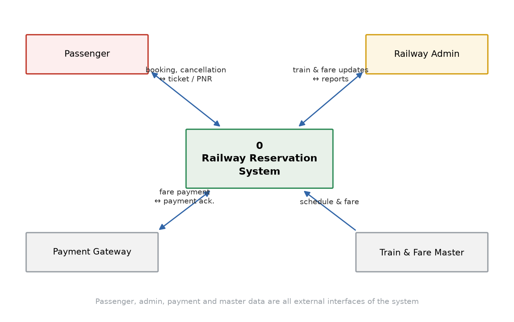
*🖼️ Figure 10 — Level 0 (context) DFD: passenger and admin interact with the reservation system; the payment gateway and train/fare master are the other interfaces.*

**Level 1 — main processes.** The single bubble is exploded into **1.0 Check availability & book ticket**, **2.0 Cancel/refund ticket** and **3.0 Generate reports & MIS**, with the data stores under them.

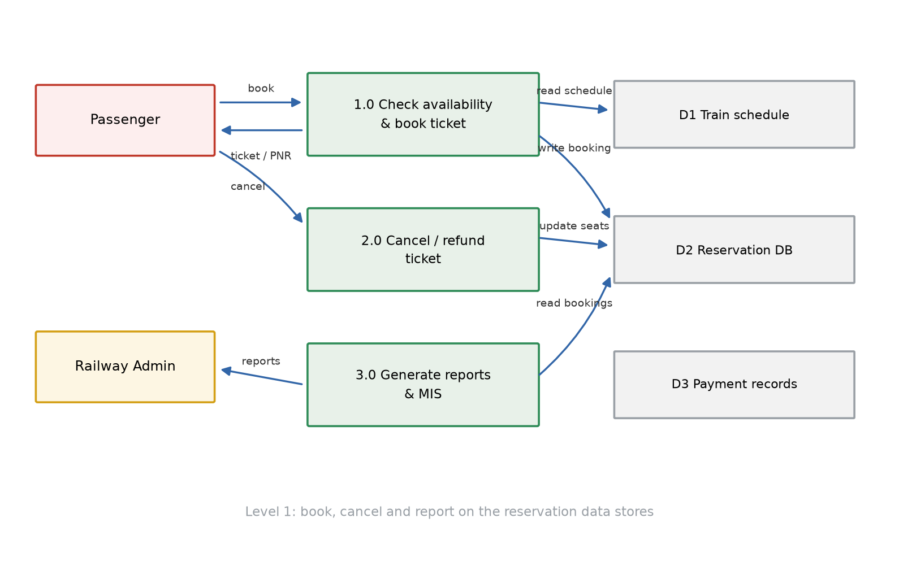
*🖼️ Figure 11 — Level 1 DFD: 1.0 reads D1 and writes D2, 2.0 updates D2, 3.0 reads D2 and reports to the admin.*

**Level 2 — explode 1.0 Book Ticket.** The booking process is refined into five sub-processes: **2.1** select train/class/date, **2.2** check seat availability, **2.3** enter passenger details, **2.4** collect fare (payment), **2.5** confirm booking and issue PNR.

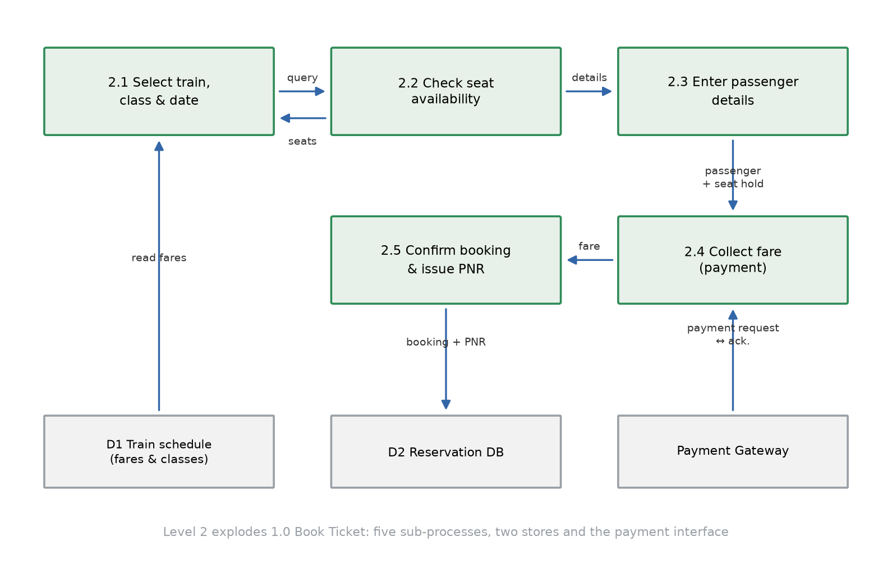
*🖼️ Figure 12 — Level 2 DFD: 2.5 writes the confirmed booking to D2 and returns the PNR; payment records go to D2/D4 through the gateway.*

**Hence** the first three DFD levels for the Railway Reservation System are: level 0 — the context diagram with one process and four external entities; level 1 — 1.0 book, 2.0 cancel and 3.0 report over three data stores; level 2 — the five sub-processes of booking, each level refining the one above while keeping the flows balanced.

## ✅ Verification (Q1(e) block)

| Standard | Check | Result |
|---|---|---|
| Source-grounded | SRS outline, SRS qualities, DFD symbols/levels/rules, data dictionary, E-R from Block 1 U2 §2.2–2.3, pp. 562–578 | ✅ |
| Paraphrased (IGNOU rule) | Own wording; outline and rule lists reproduced as structure of record | ✅ |
| Structure | L0 → L1–L2 → traps/self-check → exam trail → full 20-mark SRS → 2 TEE answers → verification | ✅ |
| Assignment answer | Complete IEEE-830 SRS: 4 sections, 10 FRs, 9 NFRs, DB schema, 3 appendices; ≈ 1 650 words + tables → ~35–40 min handwritten | ✅ |
| Question-first | Verbatim part (e) + shared case; both TEE answers embed their questions | ✅ |
| Figures | Figs 8–9 in the study/SRS; Figs 10–12 in the DFD TEE answer, all captioned | ✅ |
| TEE layer | 2 answered standalone at paper marks; 2 blocked with the exact missing units | ✅ |
| Registry | SRS, IEEE outline, DFD rules, data dictionary, E-R, traceability recorded once | ✅ |

---

# ✅ Final verification (whole workbook)

| Standard | Check | Result |
|---|---|---|
| Source-grounded | Q1(a) → Block 1 U1 (pp. 545–561); Q1(b)/Q1(e) → Block 1 U2 (pp. 562–578); Q1(c)/Q1(d) → Block 2 U5 (pp. 608–620) | ✅ |
| Question-first | Case quoted in full in the header; all 5 assignment parts and all 12 TEE answers embed their verbatim question; no question figure existed | ✅ |
| Paraphrased (IGNOU rule) | Study blocks rewritten from the units; tables/equations reproduced only as data of record | ✅ |
| Symbol standard | Every symbol/abbreviation (SE, SDLC, SRS, SDD, FR, NFR, RE, RDD, FP, UFP, VAF, GSC, LOC, KLOC, PM, E, D, K, T, Ck, DFD, RBAC) has a read-aloud, purpose and example | ✅ |
| Assignment coverage | Q1(a)–(e) all answered standalone with the case's own data: paradigm + justification; 10 FR + 9 NFR; ₹11.24 lakh cost; 10.4 PM effort; full IEEE-830 SRS | ✅ |
| Numbers verified | UFP 73; ΣFᵢ 46 → VAF 1.11 → 81 FP; 4.05 KLOC; E = 10.42 PM; D = 6.09 months; cost 10,22,000 + 1,02,200 = **11,24,200**; phase split 1.0/2.1/4.2/3.1 = 10.4 PM; cross-checks 10.1 PM (productivity) and 6.6 months (schedule formula) | ✅ |
| Figures | 12 figures in `MCS-213_Assignment_Workbook.assets/`, all referenced with numbered captions and viewed before use | ✅ |
| TEE layer | Real past questions only; **12 answered** standalone at paper coordinates and marks; others marked queued/blocked with reasons | ✅ |
| Registry | Every concept listed once with its first-teaching location; later parts link instead of repeating | ✅ |
| Exam archive | 4 sessions (Dec-2024, Jun-2025, Dec-2025, Jun-2026) swept via the annotated MDs in `SEM1/Question Papers/MCS-213 - Software Engineering/` | ✅ |

**TEE bank sweep (all MCS-213 questions, 4 archived sessions):**

| State | Questions |
|---|---|
| ✅ **Answered (12)** | Jun-2026 1(a), 1(b), 3(a), 3(b) · Jun-2025 1(a), 1(d), 4(a), 4(b) · Dec-2025 1(a), 3(a) · Dec-2024 1(a), 1(b) |
| 🔓 **Unlocked — queued** (concepts taught, standalone answer deferred) | Jun-2026 5(b) software metrics (only this short note is coverable; the other three parts of Q5 need Units 8/14) |
| ⏳ **Blocked — needs more lessons** | Testing depth (Unit 7): Jun-2026 1(d); Jun-2025 2(b), 3(a); Dec-2025 4(a) · Risk management & scheduling (Unit 6): Jun-2025 2(a); Jun-2026 4(b); Dec-2025 1(d), 4(b); Dec-2024 4(b) · Design, modularity, coupling/cohesion, HCI (Unit 3): Jun-2026 1(c); Jun-2025 3(b); Dec-2025 1(b), 2(a); Dec-2024 5(b) · Quality, SQA, metrics, reliability (Unit 4): Jun-2026 2(a); Jun-2025 1(c); Dec-2025 2(b); Dec-2024 5(a) · Maintenance, SCM, re-engineering, reverse engineering, debugging, FTR, Cleanroom (Units 1 §1.5, 7, 8): Dec-2025 1(c), 5(b), 5(d); Jun-2026 2(b), 4(a), 5(d); Jun-2025 5(b); Dec-2024 2(a), 2(b), 3(a) · Web & mobile (Units 9/10): Dec-2024 1(c), 4(a); Jun-2025 5(a) · CASE tools (Unit 11): Dec-2024 3(b) · Process improvement, reuse, agile, UX, CBSE, process optimisation, global teams (Units 12–16): Dec-2025 5(a), 5(c), 3(b); Dec-2024 1(d); Jun-2025 1(b); Jun-2026 5(a), 5(c) |

**Coverage after this pass:** the **full 80-mark assignment** and **12 of the 52 archived question-parts** carry standalone answers — every question that depends only on Units 1, 2 and 5 (models, requirements, estimation, SRS/DFD) is complete; a further **1 is unlocked and queued** and the remaining **39 are blocked** with the exact unit that unlocks them.

